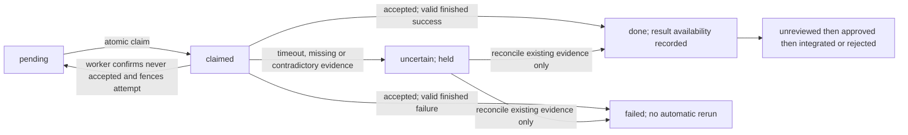

# Astra review and execution plan: ADR-029 repair and ADR-044 pilot

Date: 2026-10-02. Status: final planning review for Opus 5.5 or Fable; ADR-044 remains proposed. This document authorizes nothing by itself. The task-specific planning restriction supersedes `ASTRA_ONESHOT.md`.

**Recommendation:** approve a bounded M0 repair before M1, with three corrections to Opus: an absent receipt is insufficient evidence to retry; a completed nonzero run can already have side effects; and timing out a client attached to a shared server does not bound server execution. Use plain OpenCode for M0, hold accepted failures, and require a worker-side fence before requeueing an unaccepted request.

## 1. Evidence and challenge

All repository citations refer to the working files read on 2026-10-02, not a deployed revision. Existing modified/untracked files were present at intake. The only artifact authored by this review is this file. No queue script, test, installer, host check, SSH command, authentication command, service command, commit or push was executed. Official documentation was fetched; installed versions and host state remain unverified. Example commands below are proposed future actions.

### Findings F1–F5

| Finding | Confirm or dispute | Evidence and correction |
|---|---|---|
| F1: eight runs | **Confirm the conditional path; dispute a universal maximum.** | `scripts/dispatch_job.sh:182-189` runs once immediately and enqueues on any failure; `scripts/worker_exec.sh:81-88` can invoke OpenCode twice; `scripts/drain_queue.sh:50`, `154-188`, `198-206` allow three subsequent failed queue attempts by default. With both attached and plain commands invoked on each visit, no crashes, and default attempts, `(1 + 3) × 2 = 8` CLI invocations. This is a code-path count, not eight proven completed tasks. `MAXATT` is configurable; a crash after execution but before state update can repeat the same attempt. There is no overall eight-run bound. |
| F2: orphaned remote runs | **Confirm the risk; dispute any assertion of observed survival.** | Relay timeout wraps SSH at `dispatch_job.sh:116` and `drain_queue.sh:149`. Worker execution at `worker_exec.sh:81-88` has no timeout or cancellation protocol. Whether a plain remote process survives depends on signals and process behavior; this review did not run it. The attached case is more serious: `worker_exec.sh:52-53` addresses a separately running server, so terminating the CLI cannot be assumed to terminate its server-side work. OpenCode documents server attachment and a separate session-abort API; it does not establish cancellation on client disconnect. [OpenCode CLI](https://opencode.ai/docs/cli/#run), [server API](https://opencode.ai/docs/server/). |
| F3: auto-sync collision | **Confirm for the shared checkout; qualify the worktree remedy.** | `worker_exec.sh:36`, `55`, `71-78` use and pull the replica; `node_autosync.sh:31-38`, `71-82` stages all changes, commits, rebases and pushes. Its cadence is recorded in `DECISION_LOG.md:417` and script comments `26-27`, not freshly observed. An external worktree on a distinct branch prevents ordinary staging/autostashing of that worktree's files. It does not prevent an autonomous agent from writing the original checkout, changing shared refs/config, or invoking Git against it. Linked worktrees share Git metadata; never use the synced `main` branch. A nested worktree may become an embedded-repository entry if not ignored; Opus's categorical “would stage” needs that qualification. [Git worktree](https://git-scm.com/docs/git-worktree). |
| F4: output lost on retry | **Confirm.** | `drain_queue.sh:174-187` deletes the failed attempt output at line 185. The preceding direct failure has no queue attempt archive (`dispatch_job.sh:183-188`). Retain a separate scanned output/evidence record for every attempt; unsafe output is replaced by a refusal record, never copied into ordinary logs. |
| F5: direct success has no receipt | **Confirm, including the local branch.** | Remote success exits at `dispatch_job.sh:182-184` without `enqueue_job`; `--local` exits at `177-179` after `run_local`. Queue persistence exists only at `122-150`. Route both through durable admission and the same claim/receipt rules; do not leave a second unrecorded writer path. |

### Opus verdicts 1–9

| Verdict | Confirm or dispute | File and line evidence; decision proposed here |
|---|---|---|
| 1: repair ADR-029 first | **Confirm.** | `DECISION_LOG.md:486-493` establishes the existing queue; F1–F5 above show why new backends inherit unsafe behavior. M0 is a prerequisite for an executing M1/M2, although stub-only authoring can proceed independently. |
| 2: directories for claimed/uncertain | **Confirm, with a parser/reader qualification.** | `drain_queue.sh:282` selects only `pending/*.job`, so an atomic move stops ordinary selection. Worker identity, crash recovery, status and retention still need new code (`100-127`, `191-208`, `214-234`; `job_status.sh:29-64`). A directory move alone is not the protocol. |
| 3: use .task for v2 and automatic rollback | **Confirm .task; dispute automatic safe rollback.** | Unknown headers disappear in `drain_queue.sh:114-119`. Old drain discovery at `282`, old prune at `218-227`, and old status counts at `job_status.sh:29-47` ignore `.task`. However, old status still prints the shared `completed.log` and any top-level `done/*.out` (`49-64`); old prune truncates that log (`drain_queue.sh:231-233`). `.task` state is invisible, but all related evidence is not necessarily invisible. Old pending `.job` retry semantics also remain unsafe. Rollback must hold intake/drain and preserve current receipts; do not simply restart old code. |
| 4: worker host needs owner choice | **Confirm.** | `STATUS.md:16-17`, `43-44` record readiness/trust gaps; ADR-043 at `DECISION_LOG.md:651-657` leaves standby migration and hub placement open. No host fact was refreshed. |
| 5: scripts/ first | **Confirm.** | ADR-029 names these Bash components (`DECISION_LOG.md:486-493`); the failures are inside them. M0 stays Bash, with the existing Python 3 standard library used for strict scanning/serialization where needed. No database, package framework or new third-party dependency. |
| 6: local pilot before M2 with host constraint | **Confirm conditionally.** | `M2_DISPATCH_RUNBOOK.md:4`, `40-44`, `81-82` describe missing remote prerequisites; a local transport bypasses SSH, not the queue protocol. ADR-043 at `DECISION_LOG.md:654-657` makes the host choice material. Complete M0 first. A local pilot proves no remote readiness. |
| 7: cut dashboard | **Confirm as a scope recommendation.** | `2026-10-02-sol-task-runner-adr.OUTPUT.md:84-86` does not establish an extension API. Also correct Opus's suggested fallback: `STATUS.md:17` says queued jobs have no automatic reply yet, and `job_status.sh:56-64` prints output rather than safe summaries. M0 supplies safe status; messaging stays deferred with existing M2 wiring. |
| 8: defer account profiles | **Confirm the scope cut; dispute a uniform native --dir flag.** | `worker_exec.sh:55` implements OpenCode's directory flag only. `dispatch_job.sh:153` cannot establish flags for other CLIs. M1's adapter owns `--dir`; Codex maps it to `--cd`, Claude uses a subprocess working directory, OpenCode uses `--dir` (official verification below). Host-local sign-in does not establish subscription eligibility. |
| 9: no exactly-once claim | **Confirm; strengthen the state transitions.** | `worker_exec.sh:82-88` has no side-effect rollback. Opus's `2026-10-02-opus-task-runner-review.OUTPUT.md:92-100` would retry completed failures merely because their worktrees can be discarded. A worktree cannot undo network requests, other filesystem writes or detached processes. No automatic replay follows any acceptance, including a known failed exit. |

### Further corrections needed before approval

| Opus recommendation | Assessment and required change |
|---|---|
| No accepted receipt means safe retry (`opus…OUTPUT.md:65-68`) | **Dispute.** Query failure is not absence; even a successful absence query can race a delayed start. The worker must atomically fence that specific attempt under the same metadata lock used by start, then acknowledge `not_accepted_fenced`. A delayed start must refuse the fenced attempt. |
| Worker timeout “slightly shorter” (`63`) | **Incomplete.** Define separate preparation, agent, kill-grace and receipt budgets; disallow shared-server attachment for M0. Timeout exit does not prove all external effects stopped. |
| Worktrees make auto-sync changes unnecessary (`126-128`) | **Conditionally confirm for M0/M1 only.** No `node_autosync.sh` edit is needed if runner artifacts and worktrees stay outside every synced root, job branches differ from `main`, and a root-cleanliness check passes. Pause sync during deployment and integration. This is not a shell sandbox. |
| Local bundle commit (`115-119`) | **Conditionally accept as explicit M1 permission.** Current worker policy expects no commit (`M2_DISPATCH_RUNBOOK.md:7`, `107`; ADR-016 `DECISION_LOG.md:265`). Approve only a runner-created, scanned local commit on `codex/task/<id>` for packaging. Agent commits, pushes and publication remain outside that permission. |
| Scan diff/result before package (`117-121`) | **Insufficient.** Inspect every newly reachable object, full changed file contents, paths, commit metadata, manifest and result before transport. Regex-scanning compressed bundle bytes or only a diff misses content. M1 accepts UTF-8 text changes only; changed binaries, symlinks, gitlinks and LFS pointers are held. Size caps alone do not inspect binaries. |
| Status counts before backup (`106`) | **Dispute current behavior.** `job_status.sh:49-64` prints completion content and newest output. Use filesystem counts before upgrade and a new `--counts-only` mode afterwards. |
| Deploy scripts together (`108`) | **Incomplete.** `install_dispatch_drain.sh:30-35` copies runnable helpers and `86-88` starts the timer. `65-68` hardcodes service limits. Repair installer staging/timeout handling too, and version-handshake relay and worker before opening intake. |

## 2. M0: precise implementation contract

### Scope, files and behavior

M0 remains the ADR-029 OpenCode queue. Proposed file edits below are for builder after final approval; none is made in this review. A small Bash library `scripts/dispatch_common.sh` avoids divergent parsers/state rules. Dependencies remain Bash, existing Git/GNU utilities, SSH, and the already-required Python 3 standard library. Missing dependencies fail before acceptance. Windows callers use the same scripts through a supported Bash/WSL environment; these are not native PowerShell scripts. Verifier must report the environments actually checked.

| File / function | Before | Planned after |
|---|---|---|
| `dispatch_job.sh`: `enqueue_job`, entry branches, `run_local` | Execute first; queue on failure; local path bypasses queue. | Validate/scan input; reserve unique identity; write durable record first; print its identity; call `drain_queue.sh --id <id>` for eligible immediate work. Local OpenCode uses the same worker receipt logic through a local transport. No direct CLI path remains. Existing `--local`, `--agent`, stdin/body semantics survive. `--dry-run` validates without network, queue writes or models and never prints the body/base64. |
| `dispatch_common.sh`: new parser, atomic-write, admission, locks and transitions | Similar serialization is duplicated; error returns can be ignored. | Strict key/value parsing without `source`/`eval`; whitelist fields; reject duplicate fields, malformed IDs, filename/header mismatch, traversal and symlinked state paths. `umask 077`; same-filesystem temporary file, checked write/flush and atomic rename; use existing Python stdlib for file/directory fsync. Do not print `QUEUED` or launch after failed persistence. Local POSIX storage only; NFS/power-loss semantics beyond tested filesystem behavior are unverified. |
| `drain_queue.sh`: `parse_job`, `process_job`, `run_remote`, replace `fail_job` | Pending file remains selectable through execution; exit code drives retry. | Validate, hold global drain lock, atomically move pending to claimed, allocate attempt, persist attempt metadata before transport. Execute pinned worker entry point once. Classify through worker receipts, not exit code alone. `--id`, `--counts-only` support through status, `--reconcile <id>`, and `--hold-legacy` are proposed interfaces. Reconcile never starts a model. |
| `worker_exec.sh`: new `start`, `status`, `fence`; replace pull/fallback | Pull current checkout best effort; attach then plain. | Require protocol/identity/digest/base; refuse old positional execution after rollout. Start/fence share a short atomic metadata lock. Scan input, verify base object, inspect scope locks, create external worktree; persist acceptance before any agent call. Use a single plain run with bounded worker supervision. Record checked completion/evidence; repeated start requests return existing status. No job-time pull. |
| `job_status.sh`: counts/output selection | Prints raw newest stdout and `.job` counts. | Default outputs only sanitized counts and reason codes; add `--counts-only`. Show pending/claimed/uncertain/done/failed and review states, plus `.task` held counts even before its execution is enabled. Raw output is not printed by default. |
| `drain_queue.sh`: `prune_queue`, `log_completed` | Deletes top-level `.job/.out`; trims shared log, including retry events. | Retain each job's record plus matching per-attempt evidence atomically as a unit. Never prune pending/claimed/uncertain, missing-result, or unreviewed work. Keep compact worker deduplication/fence tombstones independently of output retention. Do not delete state while a transition is in progress. |
| `verify_sanitization.py`: `scan_text` and new explicit stream mode | Tracked-file CLI; extension/name exemptions; marker-line skips; errors may print matched text. | Add strict text/stream scanning usable by Bash through Python 3 without a new package. Strict mode bypasses file-name exemptions and marker-line skips (`233-245`, `248-259`, `291-300`); rejects undecodable/oversized input and reports codes/counts only. Preserve existing default audit behavior. Scan records before queue admission and logs before retention/transfer. Do not use `--all` on runtime homes. |
| `install_dispatch_drain.sh`: copy/unit generation | Copies two helpers and enables timer immediately; fixed service budget. | Add `--no-start --release <absolute-approved-release-root>`. Install pinned wrappers and all required helper/scanner files as one release, validate absolute paths and non-secret tunables, compute unit timeouts from batch/budgets, refuse invalid zero values, and never enable timer in `--no-start`. Worker protocol path is explicitly configured. |
| `test_dispatch_queue.sh`: fixtures | Offline enqueue and simple prune only (`5-24`). | Add the cases in Section 3 with stubbed SSH/models and temporary repositories; no live hosts, real queues, native auth or user homes. |

`node_autosync.sh` is inspected but not changed in M0. Producer and timer wrappers resolve one approved release, not an independently updating working checkout. A release contains the scripts/library/scanner needed for its protocol; the worker exposes its supported protocol and release identifier before admission. Identifiers here are task-local metadata, never personal/account/session identifiers.

### Records and exact directory layout

Queue root remains `NAQUUUU_QUEUE_DIR` (default `$HOME/.naquuuu/queue`). Worker runtime root is `NAQUUUU_WORKER_STATE_DIR` (default `$HOME/.naquuuu/worker`). Both must resolve outside all synced checkouts. Proposed paths:

| Path | Meaning |
|---|---|
| `$QDIR/pending/<id>.job` | Only queued, eligible legacy-envelope/M0 record. |
| `$QDIR/claimed/<id>.job` | Durably claimed; recovery inspects receipts before any next action. |
| `$QDIR/uncertain/<id>.job` | Execution/start cannot be settled, or migrated legacy provenance is unknown. No automatic execution. |
| `$QDIR/done/<id>.job`, `$QDIR/failed/<id>.job` | Known execution outcome; `done` alone does not mean result available, reviewed or integrated. |
| `$QDIR/jobs/<id>/meta`, `attempts/<n>/dispatch.meta`, `receipt`, `stdout.txt`, `stderr.txt`, `scan.meta` | Canonical job metadata and separate evidence for every transport attempt. Output files exist only after a successful strict scan; otherwise `scan.meta` records refusal. Attempts are never overwritten. |
| `$QDIR/jobs/<id>/result/`, `review.meta` | M0 four-block handoff and worktree reference; M1 package and review state. No new top-level `done/*.out`. |
| `$QDIR/events.log`, `drain.lock`, `maintenance` | Sanitized transitions; global lock; intake/drain maintenance sentinel. No bodies in events. |
| `$WSTATE/receipts/<id>/task.meta`, `metadata.lock.d/`, `<n>.accepted`, `<n>.finished`, `<n>.rejected` | Worker binding/deduplication ledger and immutable attempt receipts. A rejected/fenced attempt can never be accepted later. |
| `$WSTATE/attempts/<id>/<n>/`, `$WSTATE/scopes/<repo-slug>.lock.d/` | Scanned worker evidence and conservative one-writer-per-repository scope lock. Retain the lock while execution is uncertain. |
| `$HOME/.naquuuu/wt/<repo-slug>/<id>/` | External worktree at exact base; branch `codex/task/<id>`, never `main`. Configurable via `NAQUUUU_WORKTREE_ROOT`, validated outside synced roots. |

M0 keeps the old `.job` body envelope (`id`, `created`, `agent`, `attempts`, blank line, body), so the repaired parser still accepts fixtures with that shape. New `jobs/<id>/meta` supplies mandatory `protocol: 1`, `task_sha256`, repository slug, full `base_oid`, transport `local|ssh`, relative permitted paths, and review/result states. Absence of metadata is **legacy-unknown**, not automatic authorization to execute. Migration places such real queued jobs in `uncertain/`; after owner review, repaired tooling admits them with a pinned base and provenance. A fixture known never to have run can exercise legacy parsing and drain normally.

Receipt format is UTF-8 header lines, with no executable syntax. Shared fields: `protocol`, `id`, `attempt` (positive decimal), `task_sha256`, `repo_slug`, full `base_oid`, `worker_release`, `state`, and `recorded_epoch`. Accepted adds `mode: plain` and `worktree_rel`; finished adds `agent_exit`, `reason`, `process_group_stopped: yes|unknown`, `result_state: available|missing|blocked`, and safe output hashes. Rejected adds `reason: not_accepted_fenced|invalid_input|base_missing|scope_busy|unsupported_protocol`. IDs must match filename and immutable task digest. Any missing field, contradiction or digest mismatch produces `uncertain`, never a guessed result. Receipts contain no CLI conversation IDs, account details, prompts or credentials.

### Acceptance, fencing and recovery

1. Admission serializes and scans the exact task, checks active brief locks and records a full base object ID. A missing/unavailable base queues or refuses; it never falls back to current worker HEAD. Task identity is reserved across every state, including terminal tombstones. Reusing an ID with different content is refused.
2. Drain takes its existing global lock, then atomically claims before transport. Worker `start` takes the per-task metadata lock; validates the request; rejects any previously accepted task or fenced attempt; prepares the isolated worktree under a repository scope lock; writes and flushes acceptance; and only then starts OpenCode once. It may release the short metadata lock after acceptance while retaining the scope lock. A crash before acceptance but after reservation leaves an unresolved marker, not permission for another writer.
3. On a lost start response, `fence <id> <attempt> <digest>` takes that same metadata lock. If acceptance exists, it returns accepted/finished. If acceptance is conclusively absent, it writes and flushes `<n>.rejected` before returning `not_accepted_fenced`. A delayed old start must see that tombstone. Unreachable worker, ambiguous/stale lock, or partial metadata means `uncertain`. A plain `test ! -f accepted` is prohibited as retry evidence.
4. A fenced pre-acceptance transient failure may return to pending with attempt incremented; the next tick may make a new attempt. `NAQUUUU_MAX_ATTEMPTS` now caps transport attempts before acceptance only. Invalid input/base/protocol failures become failed/blocked without repeated runs. Any acceptance prohibits automatic model re-execution, including after known nonzero completion. An owner-approved correction uses a new task linked by `supersedes`, after checking side effects and releasing scope ownership explicitly.
5. Drain startup reconciles stale claimed records without executing them: valid finished receipt settles the outcome; accepted-but-unfinished is uncertain; no acceptance requires a successful fence; unknown remains held. Retrieval of an existing result can retry idempotently without invoking a CLI. Owner reconciliation can settle uncertain, but expiry or reboot alone never resets it. Deduplication receipts survive queue rollback and pruning.



### Exit handling and process budget

Separate `transport_rc`, `agent_exit`, and receipt validity. The OpenSSH manual documents remote-command status versus 255 for an error; the code cannot treat 255 as proof of no start. [OpenSSH ssh](https://man.openbsd.org/ssh). GNU timeout documents 124, internal/launch errors 125–127, and kill status 137. [GNU timeout](https://www.gnu.org/software/coreutils/manual/html_node/timeout-invocation.html).

| Observed return | Required queue action |
|---|---|
| 0 | Only valid matching finished receipt with `agent_exit=0` and stopped execution settles done. No receipt or malformed completion means uncertain. Missing archive sets `result_state=missing`, never review-ready; retry collection only. |
| 124 | Immediately hold uncertain; never requeue automatically. A later explicit reconciliation may settle a completed receipt. Retain timeout metadata even if another receipt subsequently arrives. |
| 255 | Accepted without finished, unreadable receipts, or failed reconciliation => uncertain. A positively acknowledged `not_accepted_fenced` permits one requeue transition for that attempt, within the attempt cap. A valid finished receipt settles done/failed without rerunning. |
| Other nonzero, including 1/2/125/126/127/137 | Valid accepted+finished nonzero => failed without replay, unless process termination is unknown, in which case uncertain. Proven pre-acceptance transient refusal may requeue under the fence rule. Invalid task/protocol/base => held/failed. Unknown evidence => uncertain. Exit 137 is never treated as proven cleanup. |

Proposed defaults (configuration choices, not performance measurements): relay execution timeout `R=1800s`; worker preparation at most `30s`; worker agent timeout `A=1680s`; TERM-to-KILL grace `K=10s`; receipt/evidence finalization at most `30s`; reconciliation at most `30s`. The worker stages total at most `1750s`, leaving `50s` inside the relay envelope; network delay can still exceed it, which leads to uncertain. Validate `R > preparation + A + K + finalization`; reject zero, negative and nonnumeric values rather than disabling bounds. Recompute when customized.

Worker uses `timeout --signal=TERM --kill-after=10s 1680s` around the one plain CLI process group, without `--foreground` or `--preserve-status`. A supervisor persists an interrupted/uncertain outcome if termination cannot be confirmed; SIGKILL can prevent a final receipt and must leave acceptance intact. Detached subprocesses/external actions are not made transactional by this timeout. If process-group liveness remains unresolved, retain the repository scope lock. Timer unit start budget must exceed `BATCH × (R + reconciliation + collection_budget) + margin`; propose collection `60s`, margin `60s`, default `1950s` for batch 1. Installer validates the formula rather than keeping its current fixed 1900 seconds. Stop behavior must preserve a claimed record, not mark it pending.

### Attach-server health probe and deliberate M0 limit

The correct health endpoint is `GET /global/health`, requiring a successful HTTP response and JSON `healthy: true` with a version string. A listening port or HTTP 401 is not a healthy authorized probe. Use a bounded Python-stdlib `urllib` request (five-second outer timeout, redirects refused, loopback endpoint allowlist), with native runtime authentication supplied by the owner if configured; never print auth, response bodies or exception URLs. No `curl` or `jq` dependency is added. [OpenCode server](https://opencode.ai/docs/server/).

**M0 selects plain execution before acceptance, regardless of shared-server health.** The probe may record sanitized `healthy|unavailable|unauthorized|invalid` readiness, but does not enable `--attach`. This intentionally changes Opus's recommendation: a healthy shared server still owns processes outside the CLI timeout group. To re-enable attachment later, require a pinned per-attempt server/session, authenticated cancellation and verified stop evidence; merely calling the documented abort endpoint is not proof of quiescence. Shared-server lifecycle work is outside M0/M1.

### Evidence, sanitization and worktree limits

Task stdin is scanned before durable queue admission, then again after transport before acceptance. Retain the exact admitted digest; no task-controlled absolute path, shell fragment, backend executable or remote URL is executed. Agent output streams through bounded strict scanning before entering the normal artifact store; do not tee raw stderr to the relay or journal. Per-attempt metadata survives even if output is blocked, malformed, oversize, empty or interrupted. Proposed cap: 1 MiB admitted text and 8 MiB combined output per attempt, with explicit refusal on overflow; no silent truncation represented as complete evidence.

Strict mode must not inherit `scan_text`'s marker-line exemptions or `scan_file`'s allowed basenames. Its default CLI also misses `.job`, `.task` and `.out` through extension selection (`verify_sanitization.py:93-96`, `147-151`), so a normal tracked-tree pass does not cover a runtime queue. Full changed UTF-8 text, output, manifest and diagnostics are scanned explicitly. Synthetic fixtures must include bypass marker text, new files, commit messages and error paths. Passing these fixtures establishes that coverage, not universal privacy enforcement; ADR-016 remains accurate.

Pin the base and use an external branch/worktree; do not pull/rebase during a job. Check the synced checkout's status/index/HEAD before and after, and require it clean throughout the stub fixture. A real autonomous shell can still reach other paths; path allowlists plus a diff audit detect some violations but do not isolate a Unix user. M0 completion retains the worktree and reports its location/revision for owner inspection; it does not pretend stdout transported file changes. The complete portable package is M1.

## 3. M0 fixture test plan

These cases extend `scripts/test_dispatch_queue.sh` after implementation. They are specifications, not test results from this review.

Harness: temporary `TEST_ROOT`, local Git fixtures and disposable queue/worker directories; never point `NAQUUUU_WORKSPACE` at the real hub for a writer. Put stub `ssh`, `opencode`, `codex`, `claude`, `agy` and service/network sentinels first on `PATH`. `NAQUUUU_WORKER_KEY` names an empty synthetic file, never a real key. SSH stub recognizes only protocol/readiness/fence/result requests, logs operation names and delegates locally to the fixture worker. Unexpected destination/command fails. No installed CLI is reachable through the test PATH. Use process barriers/marker files for races, not arbitrary sleeps. Real local Git may be used; push/fetch-to-network are forbidden by the fixture.

| Name | Setup | Expected state and assertion |
|---|---|---|
| preaccept-255 | First start transport returns 255 without acceptance; fence writes rejected. Second tick succeeds. | Exactly one return to pending, one rejected receipt, two transport attempts, one model invocation total; done after second attempt. |
| delayed-start-fenced | Hold first start before worker metadata lock; fence completes; release old start; admit next attempt. | Old attempt cannot accept; only new attempt invokes model. |
| postaccept-255 | Worker flushes acceptance, stub transport disconnects before finished. Drain three more ticks. | uncertain; one model start total; zero further starts; scope lock retained. |
| receipt-query-unreachable | Start returns 255 and status/fence also fails. | uncertain even if no receipt is visible to relay. |
| relay-124 | Stub timeout path reports 124 after acceptance, with no completion. | uncertain, retained attempt evidence; never automatic pending. |
| accepted-nonzero | Model writes synthetic file then exits 1; valid finished receipt. | failed with one invocation; no deletion/retry of worktree or effects. |
| success-receipt-required | Return transport 0 with missing/malformed/wrong-digest receipt; separately valid success. | uncertain for each invalid case; valid case done, archive intact. |
| crash-after-claim | Terminate fixture drainer after atomic claim; restart it. | No extra execution; reconciliation/fencing only; accepted cases remain held. |
| duplicate-submit/start | Concurrent same ID/digest starts; also mismatch digest, malformed ID and symlink state directory. | At most one accepted model start; conflicts refused; no writes outside fixture roots. |
| legacy-job | Create exact original envelope, then admit with fixture-proven never-run provenance and pinned base. | Repaired code drains `.job` once. Separate unknown-provenance legacy record becomes uncertain. |
| old-code-task-visibility | Use a frozen pre-change fixture copy of original drain/status; populate `.task`, claimed and uncertain records; add safe shared log/top-level `.out`. | Old drain executes none of those records; prune leaves `.task`; counts ignore them. Status still exposes log/.out and prune trims log: captures the qualified finding rather than falsely asserting total invisibility. |
| synced-checkout-clean | Agent stub edits only external worktree while verifier snapshots root status/index/HEAD; run a stubbed auto-sync tick that refuses network. | Synced checkout clean and no job file staged/committed there. Put forbidden nested worktree path in a negative case: admission refuses it. |
| base-and-scope | Missing base, dirty root, active brief lock, existing scope owner; test spaces and UTF-8 paths. | No model acceptance; bounded reason code; no fallback to worker HEAD. |
| single-mode-and-timeout | Stub shared server health success/failure/401/malformed response; agent exits 1; test TERM-resistant descendant. | Mode stays plain; never attach/fallback. Timeout applies configured worker budget and kill grace; unknown termination retains uncertain/scope lock. |
| attempts-retained | Two fenced transport failures followed by success; one unsafe synthetic output. | All attempt metadata remains; all safe outputs remain distinct; unsafe bytes never enter artifacts/status/events, refusal recorded. |
| canary-boundaries | Generate synthetic patterns in memory at admission, stderr, result, manifest and full changed file; include scanner marker bypass. | Rejected before model/durable admission or before egress as appropriate; no matched bytes in logs, errors or ordinary archives. No real secrets used. |
| installation-and-retention | Stub `systemctl`; use nondefault batch/timeout; invoke proposed `--no-start`; prune mixed terminal/unreviewed/uncertain records. | No timer start; computed unit budget correct; pinned release complete; only eligible reviewed terminal artifacts pruned; tombstones preserved. |

Before later commit, verifier runs the normal sanitization gate and multi-repo audit; unresolved unrelated dirty repos are reported, not cleaned/committed as part of this task. No live SSH is part of M0 fixture success. Host validation is a separate owner gate.

## 4. M1: one local multi-CLI handoff

M1 starts after M0 fixtures pass and owner host/terms choices are recorded. The queue root on the selected machine is an isolated pilot namespace with the same protocol; it is not a second production scheduler. Codex produces a bounded Tier 2 task specification; deterministic admission validates and writes it. Claude **or** OpenCode executes it at the pinned base. A reviewer receives the package without access to the author's native conversation. AGY remains human-operated under `DECISION_LOG.md:189-193`.

### v2 .task contract

Use UTF-8 JSON in `.task`, parsed with existing Python 3 stdlib, never sourced by Bash. Proposed required/conditional fields:

| Field group | Fields and validation |
|---|---|
| Identity | `schema_version: 2`, `task_id`, `created_at`, `task_sha256`, optional `supersedes`. Digest covers canonical immutable payload excluding digest itself. Unknown version/field or duplicate JSON keys rejected. |
| Task and source | `goal`, `repo_slug`, full `base_oid`, `permitted_paths[]`, `success_criteria[]`, `brief_ref`, `brief_sha256`. One repo per pilot task; no arbitrary host filesystem paths. Goal is bounded text. Paths are canonical repo-relative literals; directory overlap includes descendants and ancestors. |
| Routing | `backend: codex|claude|opencode`, `role`, `execution_host_label`, `transport: local`, `permission_policy`, `timeout_seconds`. Executable/model configuration comes from an owner-reviewed local registry, not task text. No profile, token or auth-file field. |
| Handoff | `context_refs[]` with path/digest, `attachments[]` with relative path/type/size/SHA-256 (empty for first pilot), `result_ref`, `artifact_policy: text_bundle_v1`. M1 starts without binary/image attachments. |
| Control sidecar | Attempt number, claim/accept receipts, worker release, execution/result/review state, gate evidence references and package digest live in `jobs/<id>/` metadata; do not rewrite an admitted task or duplicate authoritative directory state inside it. |

Do not disguise `.task` as `.job` on migration or rollback. Repaired M0 counts and holds `.task` but only the explicitly enabled M1 consumer executes it.

### Thin adapter and official command verification

Proposed common interface: `scripts/task_adapter.sh --backend codex|claude|opencode --dir <validated-worktree> --task-file <admitted-task> --out-dir <attempt-directory>`. Those flags are **proposed local interface**, not vendor CLI flags. It accepts no raw arbitrary command. It normalizes completion, emits a four-block result, captures exit/evidence through the scanner, and delegates lifecycle to the M0 supervisor. No adapter performs admission, retries, commits or pushes. An existing configured model may be used after the owner verifies it matches the intended role; model overrides are not invented here.

Official examples, quoted exactly and briefly from fetched documentation:

| CLI | Documented example | Source |
|---|---|---|
| Codex | `codex exec --ephemeral "triage this repository and suggest next steps"` | [OpenAI non-interactive mode](https://learn.chatgpt.com/docs/non-interactive-mode) |
| Claude | `claude -p "query"` | [Claude CLI reference](https://code.claude.com/docs/en/cli-reference) |
| OpenCode | `opencode run --attach http://localhost:4096 "Explain async/await in JavaScript"` | [OpenCode CLI](https://opencode.ai/docs/cli/#run); attachment is documented but deliberately disabled in this pilot. |

Proposed pilot invocations below combine verified flags; these complete command combinations are **not vendor quotations or locally tested commands**. `TASK_PROMPT` and `PROMPT_FILE` are scanned adapter-generated task context; `WT` and `OUT` are validated paths. Redirections shown describe private scanner capture, not public/raw log retention.

```bash
# Codex: new bounded session, stdin prompt, final result plus events.
codex --ask-for-approval never exec --cd "$WT" \
  --sandbox workspace-write --ephemeral --json \
  --output-last-message "$OUT/final.pending" - < "$PROMPT_FILE"

# Claude: select cwd in the subprocess; allow only native read/edit tools.
(cd "$WT" && claude -p "$TASK_PROMPT" --output-format json \
  --permission-mode dontAsk --tools "Read,Edit,Write" \
  --allowedTools "Read,Edit,Write" --disallowedTools "mcp__*" \
  --no-session-persistence)

# OpenCode: one fresh plain run under the approved worker agent policy.
opencode run --dir "$WT" --agent naquuuu-builder --format json "$TASK_PROMPT"
```

The Claude command fits the text-edit pilot; deterministic verification runs outside the model afterward. Codex's workspace sandbox and Claude's tool selection do not establish identical security boundaries. OpenCode needs its existing agent policy inspected against the pilot before activation. For all three, shell/MCP configuration and inherited hooks must be reviewed on the chosen host by the owner; “headless” is not permission equivalence. A blocked permission ends the attempt; no retry with broader flags.

| Vendor option used or discussed | Documentation status on 2026-10-02 | Installed compatibility |
|---|---|---|
| Codex `exec`, `--cd`, `--ask-for-approval never`, `--sandbox workspace-write`, `--ephemeral`, `--json`, `--output-last-message`, stdin `-` | **Verified** in [developer commands](https://learn.chatgpt.com/docs/developer-commands) and [non-interactive mode](https://learn.chatgpt.com/docs/non-interactive-mode). | **Unverified**; owner/verifier checks version and help on selected host before enabling. |
| Claude `-p`, `--output-format json`, `--permission-mode dontAsk`, `--tools`, `--allowedTools`, `--disallowedTools`, `--no-session-persistence` | **Verified** in [CLI reference](https://code.claude.com/docs/en/cli-reference); permission behavior also in [programmatic guide](https://code.claude.com/docs/en/headless). | **Unverified**; no local CLI executed. |
| OpenCode `run`, `--dir`, `--agent`, `--format json` | **Verified** in [CLI reference](https://opencode.ai/docs/cli/#run). Agent name is a workspace mapping, not a vendor-defined role. | **Unverified**; deployed config/version not read. |
| OpenCode `--attach` | **Verified** flag; excluded from M0/M1 execution. Health does not verify cancellation. [CLI reference](https://opencode.ai/docs/cli/#run) | Stop/lifecycle behavior **unverified**. |
| Native Claude `--dir`; generic “all CLIs use --dir” | **Unverified / unsupported by the inspected reference**; do not emit it. Shell cwd is the planned mapping. | Not used. |
| Adapter `--backend`, `--task-file`, `--out-dir`; new queue/installer flags | **Proposed**, not installed or official vendor capabilities. | To be implemented and fixture-tested. |

No command selects or proxies `agy`; backend validation rejects it. Add a PATH sentinel and configuration checks to prove no adapter invokes AGY or an AGY proxy in the fixture. Native sign-ins remain owner-managed, and no account rotation or token transfer is introduced. Provider terms/access remain a separate owner decision; fetched CLI capability is not terms clearance.

### Bundle, manifest and result

Proposed result package under `jobs/<id>/result/`:

| Path | Required content |
|---|---|
| `manifest.json` | Schema, task/attempt digest, repo slug, base and head OIDs, exact exported ref, full path/change-kind/mode/hash list, deletions with old hashes, bundle bytes/hash, text policy, CLI version/backend, gate evidence hashes. No local username, absolute home path, account or transcript IDs. |
| `changes.bundle` | Exactly one approved task ref based on `base_oid`; no tags, other branches or unrelated refs. One runner-created local commit containing the final scanned snapshot. No bundle for a valid no-change result; explicit `no_changes: true`. |
| `result.md` | Exactly Result / Files Changed / Evidence / Blockers, with factual check results and unresolved concerns. |
| `evidence/` | Sanitized receipt, gate summary, normalized adapter status and approved fixture output. No raw CLI transcript. |

The runner, after the model exits, enumerates changed and untracked paths, rejects outside-scope changes, binary/symlink/gitlink/LFS content, and stages only admitted paths. It scans full staged content plus result, filenames and proposed commit metadata **before** the local packaging commit. Existing tracked-repository sanitization also runs before that commit, but does not replace strict scanning. Use a fixed non-personal packaging identity; preserve source author attribution in the handoff rather than copying unknown native identity settings. One local commit on `codex/task/<id>` requires the explicit M1 permission described above. If model-created commits are detected, hold for review instead of bundling their history.

Create a bundle from `"$BASE..refs/heads/codex/task/$ID"` only after verifying ancestry and exact commit count. Before egress, enumerate every newly reachable commit/tree/blob and scan its metadata/content; verify that manifest, changed paths and bundle ref agree. Proposed package cap: 20 MiB and 100 changed text files, configurable only by owner policy. Reject overflow rather than truncate. Git bundle supports transferring objects and verifying prerequisites, but `git bundle verify` is not a content or task-success audit. [Git bundle](https://git-scm.com/docs/git-bundle).

For a local pilot, copy the scanned package atomically within the pilot namespace. For later M2, relay pulls by its existing authorized transport into a bounded quarantine directory, validates structure/hash/ref/base again before ordinary retention, and never executes package paths. Retry package retrieval without rerunning the task. The integrating host verifies in an isolated review repository first; it fetches only the declared ref into a review ref and reviews exact diff plus gates. Recheck active brief locks and the destination base before owner-authorized integration. Do not merge automatically from an exit code or bundle verification. Any changed destination base requires a new conflict/review decision. Never import the hub's `blog/` or `projects/` as nested tracked repositories; later multi-repo tasks need separate packages and admission per repo.

### Brief-lock admission and pilot acceptance

`internal-docs/briefs/README.md:15-16` gives locks a brief name/timestamp and forbids writes to paths referenced by an active brief. That format has no machine-readable path list. Do not guess scope from prose or only compare lock filenames. For M0/M1, conservatively block a repository writer if any active brief lock references that repo or cannot be scoped unambiguously. An owner-reviewed path manifest can narrow this later. Check admission, worker acceptance and integration; retain the runner's repository scope lock while active/uncertain. All participating local writers must honor it. A post-run overlap audit cannot prevent a nonparticipating human/AGY writer; the pilot uses one host and an owner-confirmed exclusive work interval.

M1 acceptance uses a synthetic text-only repository/task with a deterministic expected diff: Codex describes a small documentation change and acceptance criteria; deterministic admission writes `.task`; Claude or OpenCode performs it; verifier checks changed paths, expected content, unchanged unrelated files, package integrity and four-block result. Simulate lost acknowledgement after acceptance and recover the same package with no second CLI invocation. Re-run old-code visibility and AGY-negative fixtures. Final evidence lists actual versions/flags and permissions used. Cross-CLI native transcript migration is not claimed.

### M1 extension requested by owner: quota and context handover

Add this after the basic local handoff/package pilot passes. The owner requested handover when the current CLI quota window reaches **95% used (5% remaining)**, and when context approaches capacity. Quota is provider/account access over a reset window; context is the current session's usable input/history capacity. **Opening a new chat/session does not reset provider/account quota.** A context-only handover may use a fresh session on the same eligible CLI; quota exhaustion requires waiting for reset or an eligible different provider with sufficient access. Same-provider account rotation to evade limits remains excluded.

Proposed runtime policy is separate from the immutable `.task` payload. An owner-reviewed policy selects thresholds, eligible backends and permitted fallback behavior; task text cannot override it.

| Signal | Proposed threshold/action | Evidence required |
|---|---|---|
| Quota reserve | At 90% used, request/prepare a checkpoint and avoid admitting another large step. | Documented used/remaining percentage with provider/account scope, window identifier, reset boundary and observation time. The 90% threshold is a proposed reserve, not a measured sufficiency guarantee. |
| Quota handover | At **95% used or above**, stop admitting steps to that CLI; prepare continuation for an eligible alternative or wait for reset. | Apply to every documented window that constrains this run; a weekly exhausted window is not overridden by a fresh short window. Normalize remaining to used explicitly. |
| Context reserve | At 80% of documented effective capacity, prepare a checkpoint. | Current occupied context and usable capacity for that exact session/model, or a documented native near-capacity event. This is a proposed threshold, independently configurable. |
| Context handover | At 90%, prefer a fresh session after safe checkpoint/stop, unless a documented native compaction policy is deliberately selected and verified. | A reliable current-context denominator; cumulative billed input/output tokens are not current context occupancy. No guessed percent from transcript length or nominal model marketing limits. |
| Unknown/stale | Show `unknown`; perform progress-based checkpoints after each bounded step; do not invent a threshold crossing or claim a destination has available quota. | Reject missing, contradictory, wrong-scope, expired-window or stale readings. Proposed freshness bound is 60 seconds; it is policy, not assurance against fast consumption. A provider may report limits more slowly. |

These are proactive controls, not a promise to stop exactly at 95%. A long in-flight call can consume the reserve before new telemetry arrives. Subscription quota cannot be inferred from API dollar spend. A hard provider rate-limit response can block new admissions without inventing a usage percentage; it must be classified separately from transient overload and authentication errors.

Telemetry status from this planning pass:

| Adapter | Verified source facts | Missing capability / activation rule |
|---|---|---|
| Codex | Non-interactive JSON events can report usage. [OpenAI non-interactive mode](https://learn.chatgpt.com/docs/non-interactive-mode). | A stable headless subscription-window percentage and current-context denominator were **not verified** here. Desktop account-usage tooling must not be assumed to describe a differently signed-in CLI. Enable threshold automation only when the installed CLI's supported interface exposes matching fresh fields. |
| Claude | Print-mode output and budget/turn controls are documented. [CLI reference](https://code.claude.com/docs/en/cli-reference). | A subscription-window percentage/current-context telemetry interface for this adapter is **unverified**. API spend caps and cumulative token totals cannot substitute. |
| OpenCode | JSON run events and a usage stats command are documented. [CLI reference](https://opencode.ai/docs/cli/). | Provider/account quota-window and live context denominators are **unverified** and may differ by provider. Do not infer subscription quota from `stats`. |

Do not scrape an interactive `/status` screen, intercept credentials, read auth/Hermes stores, or reverse-engineer undocumented endpoints. A later narrow official-interface review may enable a telemetry source; absent that, automated percentage-based switching remains disabled and the checkpoint workflow still works. Owner-supplied readings can support an explicit one-time decision, labelled manual and timestamped, not an unattended monitor claiming live accuracy.

The safe handover sequence is:

1. Runner records `handover_requested` and stops scheduling additional steps. If both quota and context trigger, quota determines destination eligibility. Suppress duplicate requests with a transition identity and re-arm only after a valid reset/new session; repeated samples must not create successors.
2. Finish the current bounded step or use a **documented, verified** cooperative interruption interface. The simple `exec`/`-p`/`run` commands above do not establish live checkpoint injection or transferable native sessions. For initial M1, checkpoints occur between bounded invocations. If a call fails or times out before its result, retain acceptance, reconcile and hold uncertain as in M0. Never immediately start another writer.
3. After confirmed termination, deterministic collection records parent task and attempt, original goal, permissions/forbidden actions, exact base and current tree/diff, changed and untracked files, scanned artifact hashes, actual test/gate results, failures, completed work, remaining work and blockers. A model-written summary is useful but not required to retain the diff. Mark execution `done` with `outcome: checkpointed` and task outcome `partial`; do not claim acceptance criteria passed. Incomplete/unsafe package means handover blocked.
4. Under the same repository scope lock, validate a successor task with `continuation_of`, checkpoint/package digest, explicit remaining work and no permission escalation. Choose an eligible destination using confirmed terms, privacy tier, tools/model capabilities, owner policy and fresh quota evidence. Import/verify the checkpoint before launch. For a context-only handover, the same CLI may start a fresh session if account quota remains eligible. If no destination qualifies, hold for reset/owner action. Preserve original base and checkpoint revision separately; do not lose the cumulative diff.
5. Atomically transfer scope ownership only after source stop and successor admission; then launch exactly one successor. Keep the predecessor evidence immutable. If destination launch has an uncertain outcome, apply its own receipt protocol; do not fall through to a third CLI. If import fails before acceptance, retain the source checkpoint and lock for recovery without restarting completed source work.

Additional stub cases for `test_dispatch_queue.sh`/M1 fixtures:

| Name | Setup | Expected state |
|---|---|---|
| quota-boundary | Fresh readings at 94.9%, 95.0% and 95.1% used; also 5% remaining. | Handover only at/above 95%; remaining normalizes correctly; one request despite repeated readings. |
| quota-reserve/windows | Cross 90%; then short window resets while another binding window is exhausted. | Checkpoint reserve activates; exhausted other window still prevents admission. New chat never changes quota. |
| context-boundary | Reliable context at 79%, 80%, 89%, 90%; quota healthy. | Reserve and handover thresholds separate; new same-provider session eligible only after safe stop and quota check. |
| missing-stale-mismatch | Omit capacity, stale timestamp, wrong account/window, contradictory percentages; provide cumulative usage only. | `unknown`; no fabricated percentage/routing; checkpoint after bounded step remains available. |
| accepted-or-uncertain | Trigger while source accepted and running, then lose receipt transport. | No successor model starts; uncertain holds repository scope. |
| checkpoint-failure | Unsafe/missing artifact, failed tests, absent summary or incomplete result. | Preserve safe diff/evidence; unsafe/incomplete package blocks successor; failed tests remain recorded, never relabelled passing. |
| successor-race/failure | Two simultaneous handover requests, import failure, and destination accepted then disconnected. | At most one active writer; atomic scope transfer; no fallback third run after uncertain destination. |
| destination-eligibility | Alternative lacks required tools/terms, wrong privacy tier or unknown quota; all candidates exhausted. | Hold/wait with specific reason; no same-provider account rotation, bypass flags or permission expansion. |

## 5. Migration and rollback: owner-run instructions

This runbook is for execution only after final review and implementation gates. Commands are written here, not run. New flags/installer behavior are proposed interfaces and must exist in the approved implementation. Resolve absolute paths locally; never paste host environment, keys, auth files, Hermes state or raw logs into chat. Keep the four owner decisions open until Section 7 is answered.

### Forward migration

1. **Owner — hold intake and scheduled work on the relay.** Suspend all task producers at their calling surface first, including direct/local calls; a stopped timer alone does not stop them. Keep the current relay skill routing unchanged. Stop both relevant timers during deployment, then wait for existing services rather than killing an unknown running task:

   ```bash
   systemctl --user stop naquuuu-drain.timer
   systemctl --user stop naquuuu-autosync.timer
   systemctl --user is-active naquuuu-drain.service
   systemctl --user is-active naquuuu-autosync.service
   ```

   `is-active` is an inspection with a nonzero inactive result; it is not a success/failure test for the whole rollout. If drain is active, wait for its bounded completion and reconcile the worker. If a stuck run must be stopped, record it uncertain and establish worker termination before continuing. Do not assume stopping the relay service terminates its remote work. Owner also pauses worker auto-sync and establishes no active worker before deployment, from the worker's own terminal. No new SSH trust is fabricated to bypass the existing blocker.

2. **Owner — snapshot current state privately.** Set task-specific path variables from known owner configuration; do not `source` a credential file. The following defaults are only valid if they match that configuration:

   ```bash
   QUEUE_PATH="${NAQUUUU_QUEUE_DIR:-$HOME/.naquuuu/queue}"
   BACKUP_PATH="$HOME/.naquuuu/migration-backups/$(date -u +%Y%m%dT%H%M%SZ)"
   umask 077
   mkdir -p "$BACKUP_PATH"
   for state in pending claimed uncertain done failed; do
     printf '%s ' "$state"
     if [ -d "$QUEUE_PATH/$state" ]; then
       find "$QUEUE_PATH/$state" -maxdepth 1 -type f \( -name '*.job' -o -name '*.task' \) | wc -l
     else
       printf '0\n'
     fi
   done
   if [ -d "$QUEUE_PATH" ]; then cp -a "$QUEUE_PATH" "$BACKUP_PATH/queue-before"; fi
   ```

   Validate `QUEUE_PATH` and backup resolve outside repositories and differ. Privately copy installed drain/status wrappers, units and non-secret dispatch configuration into the backup, preserving permissions and a small manifest of paths/versions/timer enabled+active state. Copy the worker receipt ledger separately on the worker after quiescence; do not transfer credential/Hermes directories. Check backup completeness locally by file hashes/counts. Do not call old `job_status.sh` for a supposedly counts-only inventory, and do not print job bodies. Existing legacy pending jobs may already have run via the old direct path; mark all without proven provenance for holding.

3. **Builder prepares, verifier checks, owner deploys the pinned release while intake stays held.** Builder supplies a reviewed release containing dispatch/drain/worker/status/common/scanner/installer and checksums; owner places it outside synced checkouts on relay and worker. Set `NAQUUUU_RELEASE` to that approved absolute release root, then on relay use the repaired installer:

   ```bash
   : "${NAQUUUU_RELEASE:?set the approved absolute release root}"
   bash "$NAQUUUU_RELEASE/scripts/install_dispatch_drain.sh" \
     --no-start --release "$NAQUUUU_RELEASE"
   systemctl --user daemon-reload
   ```

   Installer must not start a timer, rewrite credentials or silently overwrite unrelated settings. Owner sets the absolute pinned worker entry point and budgets through the existing dispatch configuration mechanism; systemd EnvironmentFile values must be literal absolute paths, not assumed shell `$HOME` expansion. Worker is deployed first; relay accepts only its matching protocol/release handshake. If trust is unavailable, deployment may remain staged with intake/timer held; it is not live activation. Archive a protocol/path checklist without host secrets.

4. **Owner runs migration; verifier reviews sanitized evidence.** With the repaired scripts, hold ambiguous legacy work, inventory all states, and check the release in an isolated fixture namespace:

   ```bash
   bash "$NAQUUUU_RELEASE/scripts/drain_queue.sh" --hold-legacy
   bash "$NAQUUUU_RELEASE/scripts/job_status.sh" --counts-only
   bash "$NAQUUUU_RELEASE/scripts/test_dispatch_queue.sh"
   ```

   `--hold-legacy` is idempotent and does not contact a worker or start a model. It keeps original bytes plus migration metadata, moves ambiguous records to uncertain, and refuses to adopt unknown versions. Verifier confirms every test uses stubs before owner runs it here. Owner separately performs a protocol-only worker status handshake after trust is ready; counts and release match, no raw receipt/body dump. A deliberately approved synthetic end-to-end task is a later live gate, with both direct and queued result collection checked; it is not implied by local fixture success. Re-admit old jobs individually only after reconciling prior execution and choosing an explicit base/scope.

5. **Owner — reopen only the approved scope.** After fixture success, compatible worker readiness, and the required live synthetic evidence, remove the maintenance sentinel through repaired administration, restore only previously enabled/active timers, then reopen producers. Typical previously enabled timers resume with:

   ```bash
   systemctl --user start naquuuu-drain.timer
   systemctl --user start naquuuu-autosync.timer
   bash "$NAQUUUU_RELEASE/scripts/job_status.sh" --counts-only
   ```

   Do not `enable --now` a timer that was intentionally disabled. Worker sync resumes after its ordinary checkout is clean and job artifacts are external. Leave `.task` execution disabled until M1 host/terms permission and pilot gates pass. Switching the production relay skill to remote dispatch still requires existing M2 worker trust, archive verification and explicit owner activation (`M2_DISPATCH_RUNBOOK.md:81-94`). No Hermes update/restart is part of this queue migration. Root may record accepted decisions/status in a later authorized documentation task.

### Rollback

1. **Owner:** close producers, stop drain timer and pause sync as above. An active/uncertain task is held and reconciled; no kill-and-retry shortcut. Take a new private snapshot of the current queue and worker receipts. Keep both before/after backups.
2. **Owner:** restore the previous approved executable release/wrappers/units from the backup, then `systemctl --user daemon-reload`. Preserve the **current** queue, attempts, accepted/fenced tombstones and packages. Never overwrite it with `queue-before`: that could resurrect completed work as pending. Do not revert the whole repository or remove unrelated edits.
3. **Owner:** keep old drain disabled and producers closed. Hold `.task`, claimed/uncertain records and any pending `.job` that may have been accepted; old code cannot understand their safety protocol. Keep a copy of the repaired status/reconciliation tool for read-only inspection while old runtime is held. `.task` extension is a compatibility barrier, not approval to restart unsafe `.job` handling.
4. **Verifier:** reconcile inventory against both snapshots, verifying no accepted task re-enters automatic execution and no result/tombstone vanished. Report only counts, reason codes and task-local identifiers. Owner confirms stopped worker processes and retained worktrees before releasing any scope lock. Revoke worker trust only through the existing owner-run process if deactivation is intended; it is not required for a code rollback and does not cancel a running job.
5. **Owner:** resume production only with a repaired compatible release and fresh gate evidence. If reverting to old code is unavoidable, keep heavy execution and automatic draining off; retained jobs remain available for manual review. Resume auto-sync only when the synced checkout is clean and deployment files cannot be accidentally published. M1 rollback disables `.task` admission/execution without downgrading records or deleting packages. This safe rollback sacrifices availability rather than risking duplicate effects.

## 6. Execution split, dependencies and review handoff

| Work | Responsible role | Dependency / parallel boundary |
|---|---|---|
| M0 protocol, worker lifecycle, dispatch/drain/status and installer | `naquuuu-builder` | One serialized author across these coupled files; reviewer approves acceptance/fence state design first. |
| Strict stream scanning and fixture cases | `naquuuu-builder` | May be authored independently of worker changes only after interfaces freeze and with distinct file ownership; tests run after stable inputs. |
| M0 fixtures, strict canaries, syntax and required sanitization/audit gates | `naquuuu-verifier` | Lower-cost deterministic role after implementation; independent static checks may parallelize. No live SSH in these gates. |
| M1 adapters, schema, packaging, then quota/context handover | `naquuuu-builder`, then `naquuuu-verifier` | Depends on M0 approval; separate adapter files can be authored in parallel, shared schema/library/packager serialize. No model runs until host/terms approvals. Percentage automation additionally requires verified telemetry; unknown telemetry still permits bounded-step checkpoints. |
| Host staging, sign-ins, migration, live canary, rollback, integration/publication | Owner | Host actions are owner-run; root reviews evidence and unresolved architecture. Existing M2 activation remains a separate gate. |

ADR-041 (`DECISION_LOG.md:637-642`) routes routine authoring and deterministic checks to `gpt-6-luna` in Codex or `opencode-go/deepseek-v4-flash` in OpenCode. Security/protocol uncertainty and evidence synthesis remain with the orchestrator/final reviewer; do not let cost override the Tier 1 boundary. No subagent delegation was used within this Astra review. Do not start a third open-ended architecture debate: the final reviewer answers the bounded choices below or returns a concrete blocker.

Suggested message for the owner to paste into Opus 5.5 or Fable:

> Read `internal-docs/briefs/2026-10-02-astra-task-runner-plan.OUTPUT.md` alongside your prior review. Plan/review only. Check the F1–F5 and verdict tables, especially worker fencing before requeue, accepted failures never retried, plain execution versus shared-server timeout, strict scanner bypasses, rollback preserving current receipts, and the owner's 95%-used quota/context handover requirement. Challenge unknown telemetry, checkpoint reserves and the stop-before-successor rule. Answer the five final questions explicitly; preserve all unresolved owner facts. A technical “yes” approves the bounded implementation plan only, with live activation still conditional on its owner-run gates. Do not execute host commands, change scripts, commit, push, accept ADR-044, or resolve owner choices by assumption.

Evidence limitations: official flags were checked on 2026-10-02; host versions, authentication, subscription eligibility, service state, process cancellation behavior and migration commands remain unexecuted/unverified. This document provides a test plan, not passing test results. Git status inspection showed a pre-existing dirty hub; those files were preserved. Required runtime audits and `/agent-viz --serve` were not run because this brief explicitly permits only reads and this one document write.

## 7. Decisions for the final reviewer

The four owner blockers below are carried verbatim from Opus's review. Opus 5.5/Fable may recommend a choice, but must not impersonate the owner's confirmation. No answer is currently recorded. Answering these provides the implementation go/no-go; implementation completion and each runtime gate remain necessary before executing a host rollout.

1. **Host.** Confirm `mipad-linux` as the execution host *and* standby relay. It needs `opencode auth login` plus the other CLI logins, done by you directly. Also decide where the hub lives after 2026-10-08 (ADR-043). **A/B:** A = use `mipad-linux` for both roles and move the hub to that personal host before 2026-10-08; B = keep host/hub placement unresolved and authorize only fixture-based M0 authoring, with M1/live rollout held. **Recommendation: A only with owner confirmation.**
2. **Pilot timing.** Choose between M1 on the laptop before 2026-10-08 (then wipe its state) and waiting for `mipad-linux` readiness. **A/B:** A = laptop pilot completed and owner-cleared before that date; B = wait for `mipad-linux` readiness. **Recommendation: B.** If Q1 is B, both execution options remain held until placement is settled.
3. **Terms.** Confirm that each CLI's programmatic or headless use is acceptable on your current plans before its adapter is enabled. **Yes/no:** has the owner confirmed eligibility for each of Codex, Claude Code and OpenCode's configured provider? **No keeps real CLI execution disabled; stub implementation may proceed.** This document supplies no terms clearance.
4. **Scope cuts.** Accept removing the dashboard (Stage 5) and account profile switching from ADR-044. **Yes/no:** accept both cuts, plus text-only single-host M1 and human-operated AGY? **Recommendation: yes.**
5. **Technical go/no-go. Yes/no:** approve the corrected M0→M1 plan, including fenced pre-acceptance retries, no automatic replay after acceptance, plain-only execution, strict scanning, external worktrees, safe held rollback, the scoped local packaging commit, and staged quota/context handover (quota checkpoint at 90% used, handover at the requested 95%; context checkpoint at 80%, handover at 90%; fresh verified telemetry or explicit unknown; source stopped before one successor)? **Recommendation: yes for implementation with the stated gates; no if any control is rejected.** A yes grants no immediate host action, account access, push, merge, M2 activation or percentage automation based on unverified telemetry.
