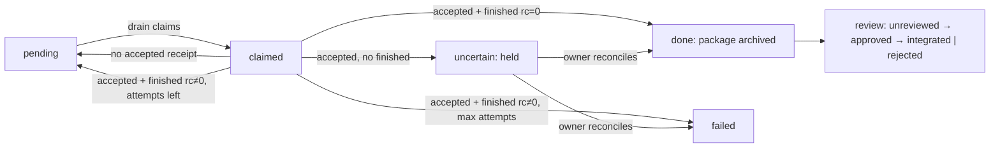

# Opus review: Sol's proposed ADR-044 (multi-CLI handoffs)

- Date: 2026-10-02
- Status: review cycle 1 of 2. Planning only; ADR-044 is not accepted.
- Inputs: `2026-10-02-sol-task-runner-adr.md`, `2026-10-02-sol-task-runner-adr.OUTPUT.md`, DECISION_LOG ADR-012/016/025/029/040/041/043, `STATUS.md`, `briefs/README.md`, and `scripts/dispatch_job.sh`, `drain_queue.sh`, `worker_exec.sh`, `node_autosync.sh`.
- All script claims below come from reading the repository on 2026-10-02. None of them comes from a live host.

### Result

Sol's revision is sound, and I agree with most of it. I disagree with three points, and one failure scenario changes the milestone. **The worker runs agents inside a checkout that auto-sync commits every 5 minutes.** Combined with the retry paths, the next step is not a multi-CLI pilot. The next step is a small repair to ADR-029 (call it **M0**). The multi-CLI handoff pilot (**M1**) comes after it.

### Files Changed

- `internal-docs/briefs/2026-10-02-opus-task-runner-review.OUTPUT.md` (this file, new). No other file was touched.

### Evidence

## 1. Verdicts on contested proposals

| # | Sol proposal | Verdict | Evidence / alternative |
|---|---|---|---|
| 1 | Extend ADR-029 rather than supersede it | **Agree, with repair first** | Retry semantics are unsafe today (Section 2). Extending them would carry the duplicate-execution bug into every backend. Do M0 before any format extension. |
| 2 | New `running` / `uncertain` states in the same queue | **Agree** | Use directories (`claimed/`, `uncertain/`) rather than header fields. `drain_queue.sh:282` selects work only by `pending/*.job`, so a directory move is the state change and needs no parser change. |
| 3 | Versioned record with legacy header parsing | **Disagree with the mechanism** | `parse_job` ignores unknown headers (`drain_queue.sh:116-120`), so an old drain would *execute* a v2 job and drop its constraints. Give v2 records a different extension (`.task`) so old drains cannot see them. Rollback is then automatic: old code ignores `.task` files, and they stay held. |
| 4 | `mipad-linux` as execution host | **Needs owner decision** | Agree in principle (ADR-043). `STATUS.md:44` still lists `opencode auth login` and a reboot as pending, and the host is also the standby relay under ADR-043, so it would carry both roles. The owner must accept that. |
| 5 | Code in `scripts/` | **Agree** | M0 has to modify existing bash. M1 adds thin adapters (one bash or Python file per CLI). Revisit only if a reusable package emerges. |
| 6 | Local pilot before M2 | **Agree, with host constraint** | A local pilot needs no worker SSH. But running it on the laptop puts personal CLI credentials and pilot state under employer management from 2026-10-08 (ADR-043). Pilot on `mipad-linux` locally, or finish it on the laptop before that date and delete its state afterwards. |
| 7 | Extend the ADR-040 dashboard (Stage 5) | **Disagree: cut from ADR-044** | Dashboard plugin support is unverified (Sol's own note). `job_status.sh` plus one WhatsApp completion message covers M0 and M1. Make the dashboard a separate ADR once the queue has real data. |
| 8 | Stage 1 "launcher with account profiles" | **Disagree on scope** | Each CLI already resolves its own native auth. M1 needs only `--backend codex|claude|opencode` on the adapter and the explicit `--dir`. Profile switching adds credential surface for no M1 benefit. Defer it until there is a concrete need for two accounts on one provider, which would also need a terms review. |
| 9 | No exactly-once promise | **Agree** | Promise "no automatic re-execution after an uncertain start" instead, as Sol wrote. |

## 2. Failure scenarios, verified in code

**F1. Up to eight runs of one task (duplicate execution).** In the worst case, a single submission can run OpenCode eight times:

- `dispatch_job.sh:186-190`: a non-zero remote run is re-queued (1 dispatch).
- `worker_exec.sh:82-87`: every non-zero attached run is retried as a plain run (x2).
- `drain_queue.sh:152-189`: each failed drain leaves the job pending, up to `NAQUUUU_MAX_ATTEMPTS=3`.

That totals (1 + 3) dispatches x 2 runs = 8. A `timeout` (rc 124) or a dropped SSH connection (rc 255) looks identical to "agent failed".

**F2. Orphaned remote runs.** `timeout` wraps the local `ssh` (`dispatch_job.sh:110`, `drain_queue.sh:149`), but the worker has no timeout of its own. When local SSH is killed, the remote `opencode` may keep running. The next drain tick can then start a second writer on the same tree.

**F3. Auto-sync collides with the worker (the overlooked scenario).** This one materially changes the milestone:

- `worker_exec.sh` runs agents in `$NAQUUUU_WORKER_REPO`, which is the synced hub replica.
- On that node, `node_autosync.sh` runs every 5 minutes: `git add -A` → gate → commit → `rebase --autostash` → push (lines 38-82).
- A sync tick in the middle of a job can therefore commit half-written agent output as `chore(sync)`.
- It can also autostash files *while the agent is writing them*.
- If the node ever gets push rights, it publishes unreviewed agent work. `STATUS.md:19` already records this class of incident (L-04).
- Worktrees do not fix this if they are created *inside* the repo. `git add -A` would stage them as embedded repositories.

**F4. Evidence is lost on retryable failure.** `drain_queue.sh:185` deletes the output of a non-terminal failure (`rm -f "$out"`), so only the last attempt's log survives.

**F5. Direct dispatch leaves no record.** A successful `dispatch_job.sh` run returns stdout to the caller and writes nothing under the queue (confirms Sol's observation).

## 3. Smallest milestone sequence

**M0 — ADR-029 repair (prerequisite for both M1 and M2; no new backends):**

1. Every dispatch writes a durable record first (F5): the direct path becomes "enqueue, then drain now".
2. The worker writes an acceptance receipt `~/.naquuuu/receipts/<id>.accepted` before starting, and `<id>.finished` with its exit code afterwards.
3. Wrap the run in a worker-side `timeout`, slightly shorter than the relay's (F2).
4. Remove the attach→plain fallback. Instead, check the attach server with a pre-run health probe and choose the mode *before* starting (F1).
5. On a non-zero exit, the relay queries receipts:
   - no `accepted` receipt → safe to return to `pending/`;
   - `accepted` without `finished` → move to `uncertain/`, never retried automatically;
   - `finished` → `done/` or `failed/` by exit code.
6. Keep the output of every attempt (F4).
7. Jobs execute in a worktree **outside** the synced checkout (`~/.naquuuu/wt/<id>`), created from an explicit base revision. That keeps auto-sync away from job output (F3).

*Done when:*
- In fixture tests, a simulated rc 255 after acceptance lands in `uncertain/` with no second run, and the same fault before acceptance requeues once.
- `git status` in the synced checkout stays clean during a job.

**M1 — multi-CLI handoff pilot (local, one host):**

1. Add a v2 `.task` record (fields per Sol's D1) and a thin adapter per backend.
2. Codex writes a record. Claude Code or OpenCode executes it in a worktree and returns the artifact package (Section 5) plus a four-block result.

*Done when:* the package verifies against its base revision, and a reviewer integrates it with `git fetch` and merge on the integrating host.

**M2 (existing ADR-029):** the same protocol over SSH once worker trust lands. No new design is needed.

## 4. State transitions (authoritative state lives on the queue owner)

- Retrying after `finished rc≠0` is safe only because the job ran in an isolated worktree. Discard the worktree before retrying.
- Review state is a separate field on `done/` records. Execution success never implies approval.

**Migration and rollback:**

1. Stop the drain timer.
2. Run `job_status.sh` to get counts (no bodies).
3. Back up `$QDIR`.
4. Deploy the new drain/dispatch/worker scripts together.
5. Leave legacy `*.job` files to drain under the repaired M0 semantics.
6. Write v2 records only as `*.task`.
7. Rollback: redeploy the old scripts. `*.task` files and `claimed/`/`uncertain/` are invisible to them and stay held.

## 5. Returning worker artifacts without push credentials

1. The worker commits locally on a job branch in the worktree. It never pushes; a local commit needs no credential.
2. It writes `git bundle create <id>.bundle <base>..job/<id>`, `manifest.json` (base revision, changed/deleted paths, hashes, gate result), and the four-block `result.md`.
3. It runs the sanitization `scan_text` logic over the diff and the result before writing the package. A failed scan marks the job `failed` with a reason only.
4. The relay *pulls* the package over its existing worker key, so the worker needs no credential back to the relay. The relay stores it under `done/<id>/`.
5. The integrating host runs `git bundle verify` against its base, then `git fetch` and review. Merging is the owner's approval step.

- Binary files ride inside the bundle. Set a size cap; a package over the cap fails rather than being truncated.
- For child repos, use one bundle per repo. The hub never bundles `projects/` or `blog/`.

## 6. Brief locks, auto-sync, and worktrees

- Admission check: refuse a task whose permitted paths overlap a path named in an active brief `.lock` (`briefs/README.md`). Repeat the check at integration, because a lock may appear while the job runs.
- Worktrees live outside every synced checkout (F3). Prune them only after the job reaches `integrated` or `rejected`.
- Auto-sync needs no change for M0/M1 once worktrees are outside the repo. Adding a "skip while a job runs" guard to `node_autosync.sh` is optional hardening, not a requirement.

## 7. Verified facts vs assumptions

| Claim | Status |
|---|---|
| Codex app-server, Claude Code headless, and OpenCode server interfaces exist | Verified by Sol on 2026-10-02; **not re-checked** in this review |
| Installed CLI versions on `mipad-linux` match those docs | Unverified |
| Each CLI's programmatic use is permitted on the owner's specific subscription | Unverified. This is a terms question for the owner, not a conclusion |
| Hermes dashboard supports a task plugin | Unverified; cut from ADR-044 (verdict 7) |
| `ssh` returns 255 on transport failure and `timeout` returns 124 | Standard tool behaviour. It cannot distinguish "never started" from "lost mid-run", which is why receipts are required |

**Privacy claims that remain policy only** (ADR-016):
- An agent on the worker can read anything its Unix user can read, including native CLI auth and `~/.ssh`.
- The only mechanical controls are sanitization at record admission and at package egress, plus canary fixtures. Neither proves absence.

## 8. Mapping to the original six findings

| Finding | Where addressed |
|---|---|
| 1. No parallel job system | Verdicts 1-3, Sections 3-4 (one queue, `.task` extension, directory states) |
| 2. Host placement (Stage 0) | Verdicts 4 and 6; Blockers |
| 3. M2 prerequisites | Section 3: M0 is a shared prerequisite; M2 reuses M0/M1 unchanged |
| 4. Enforcement realism and canaries | Section 5 step 3, Section 7 privacy note; canaries run at admission and egress in M0 tests |
| 5. AGY boundary | Unchanged from Sol's D5. AGY gets a brief only. M1 tests include an assertion that no adapter invokes or proxies `agy` |
| 6. Terms, dashboard, code placement, links, metrics | Verdicts 5, 7 and 8; Section 7. No performance numbers are claimed; the "8 runs" figure is derived from code paths, not measured |

**External links:**
- [Codex app-server](https://developers.openai.com/codex/app-server): verified by Sol, not re-checked.
- [Claude Code headless](https://code.claude.com/docs/en/headless): verified by Sol, not re-checked.
- [OpenCode server](https://opencode.ai/docs/server/): verified by Sol, not re-checked.
- [Hermes docs](https://hermes-agent.nousresearch.com/docs/): verified by Sol, not re-checked.

### Blockers

These are owner decisions, and cycle 2 cannot settle them:

1. **Host.** Confirm `mipad-linux` as the execution host *and* standby relay. It needs `opencode auth login` plus the other CLI logins, done by you directly. Also decide where the hub lives after 2026-10-08 (ADR-043).
2. **Pilot timing.** Choose between M1 on the laptop before 2026-10-08 (then wipe its state) and waiting for `mipad-linux` readiness.
3. **Terms.** Confirm that each CLI's programmatic or headless use is acceptable on your current plans before its adapter is enabled.
4. **Scope cuts.** Accept removing the dashboard (Stage 5) and account profile switching from ADR-044.

The suggested next step is a brief for M0 only (the ADR-029 repair), executed by `naquuuu-builder` with `naquuuu-verifier` running fixture tests. It is independent of the multi-CLI decision and unblocks M2 regardless.
