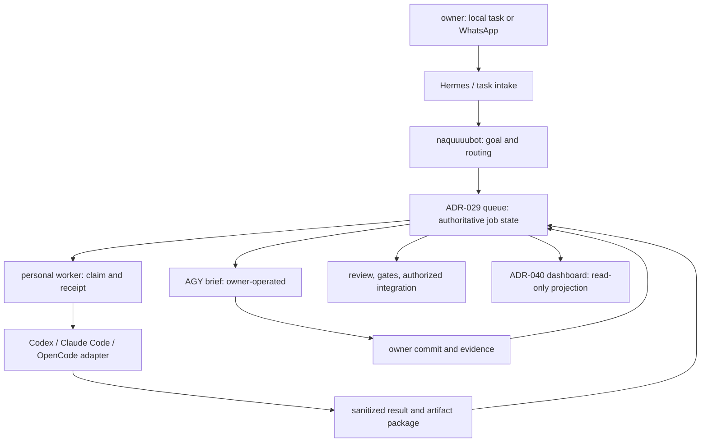

# Sol–Opus discussion: proposed ADR-044

- Date: 2026-10-02
- Status: Proposed; discussion draft, not an accepted decision.
- Source: `internal-docs/briefs/2026-10-02-sol-task-runner-adr.md`.
- Scope: planning and counterarguments only. No runtime changes are authorized by this document.

## Context

The original Sol proposal had five stages: launcher/account profiles, portable task records in SQLite plus Markdown, controlled execution, Hermes integration, and a dashboard. The intended benefit was continuing personal engineering work across Codex, Claude Code, OpenCode, and human-operated Antigravity without repeatedly reconstructing context.

Opus's brief correctly identifies existing infrastructure that proposal overlooked: ADR-029 owns durable dispatch, `internal-docs/briefs/` owns human handoffs, and ADR-040 owns dashboard access. ADR-043 also makes host placement a prerequisite. Sol withdraws the recommendation to introduce SQLite as an additional authoritative task store.

Repository observations, not live-host verification:

- `scripts/dispatch_job.sh` queues a new job after a remote execution failure. A lost SSH response can follow a successful worker start, so retrying can duplicate side effects.
- `scripts/worker_exec.sh` retries a failed attached OpenCode run through a plain run. A nonzero exit does not establish that the first run made no changes.
- `scripts/drain_queue.sh` archives stdout for successful queued jobs. Stdout is not a verified transport for modified files. Direct successful dispatch also bypasses that queued archival path.
- The worker performs a best-effort pull and continues after pull failure. This does not establish the requested source revision.
- `internal-docs/STATUS.md` reports worker SSH trust and relay wiring as blocked, and warns that auto-sync can publish agent changes without review. These are recorded snapshots, not fresh host checks.

## Counterarguments for discussion

| Topic | Sol position | Argument against it / condition for revising it |
|---|---|---|
| Reuse ADR-029 | Preserve one authoritative queue and extend its protocol. | Reusing a queue does not mean its existing retry semantics are safe. A versioned protocol and recovery design must precede unattended writes. |
| Place execution on `mipad-linux` | Personal credentials and execution belong on an owner-controlled host. | This host is a candidate, not proven ready. Availability, account setup, storage, and its standby role need owner confirmation. |
| Put implementation in `scripts/` | Extend the existing dispatch helpers; use a small module only where needed. | A standalone reusable product with independent release/dependency needs could justify a dedicated project. Four backends alone do not justify a second repository. |
| Extend the Hermes dashboard | Reuse ADR-040's access boundary and existing dashboard where supported. | Verified documentation does not establish a task plugin API. A read-only link or view is preferable to maintaining a Hermes fork; any companion view needs an explicit extension decision. |
| Cross-tool continuity | Transfer a reviewed brief, source revision, diff, and evidence. | Native transcripts, permissions, and tool state are not portable. Claiming seamless native-session migration would overstate the design. |

Additional disagreements and additions:

1. M2 is a prerequisite for remote relay-to-worker execution, but should not block an isolated local adapter experiment on the chosen personal worker. The pilot can use the same ADR-029 record format without claiming remote M2 activation.
2. Exactly-once execution is not a defensible promise for arbitrary agent shell actions. Promise no automatic redispatch after an uncertain start; use worker receipts and explicit reconciliation.
3. Review and publication need separate states. Sanitization success and a CLI exit code do not establish task success or approval. Auto-sync must not pick up experimental worktrees or pending result artifacts for publication.
4. The required first milestone should prove artifact return as well as a four-block text result. Otherwise a remote agent can report success while its useful changes remain on the worker.
5. Profile selection is configuration convenience, not a credential isolation boundary. Native auth stays host-local; no token copying, shared credential broker, or automatic same-provider account rotation is proposed.

## Decision (proposed)

### D1 — One queue and explicit migration [finding 1]

Extend ADR-029 rather than supersede it. Its queue root remains the authoritative task store; briefs are human-readable context referenced by a job, not a competing scheduler. Do not introduce SQLite, another queue, or dashboard-owned task state.

Introduce a versioned record with task ID, goal, repository slug, base revision, permitted paths, success criteria, backend, role, opaque profile label, execution host, attempt identity, attachment manifest, and brief/result references. Preserve current headers for legacy parsing where safe. Unsupported versions must be refused, not silently executed.

Propose explicit `running` and `uncertain` states within the same queue, alongside `pending/done/failed`. This is an extension requiring changes to drainer, status, retention, and direct dispatch together. Terminal execution status and review/publication status are separate fields.

Pause the drainer during migration; inventory existing jobs without printing bodies; back up locally; validate or quarantine legacy records; upgrade producer, consumer, and status reader as one rollout. A rollback must leave new-version jobs held rather than feed them to an old executor. Every invocation, including immediate dispatch, gets a durable record before execution.

### D2 — Host and account placement [finding 2]

Recommend `mipad-linux` for CLI execution and personal account profiles, subject to owner approval and readiness. The VPS remains relay and authoritative queue owner. Worker receipts and artifacts are subordinate execution records, reconciled into that queue.

Recommend moving the personal hub working checkout and credential-bearing runtime off the laptop before employer management begins on 2026-10-08. ADR-043 leaves hub placement open; this proposal does not resolve it on the owner's behalf. No credential migration occurs through agents, repository files, chat, or model context. The owner manages native sign-ins directly. DO remains subject to existing Tier 2/3 and rollout restrictions.

### D3 — Execution identity and artifact return [findings 1, 3, 6]

Keep CLI adapters thin. They accept one validated task and produce normalized status plus a four-block handoff. Preserve role/model routing from ADR-041; avoid creating four independent orchestrators.

Claim a task before execution, persist worker acceptance with task/attempt identity, and reject duplicate active requests. Lease expiry or transport loss alone never authorizes replay: mark uncertain and reconcile worker state. Remove automatic attached-to-plain retries unless a failure is proven to precede execution. Cancellation is a request until worker termination is confirmed. Arbitrary external side effects remain outside a general exactly-once guarantee.

Execute against an explicit base revision in a dedicated worktree outside auto-sync's publication scope. Resolve each repository independently; the hub never tracks child repositories. Respect active brief locks and permit one writer per overlapping scope. A path allowlist and post-run diff check are bounded controls, not a sandbox guarantee.

Return a manifest containing base revision, changed/deleted paths, content hashes, four-block result, gate evidence, and a patch plus approved new-file payloads. Include binary artifacts explicitly or reject them as unsupported. Validate paths against traversal and symlink escape, bound artifact size, scan before retention/transfer, and verify the package before integration. Text output alone cannot mark a write task review-ready. Changes remain uncommitted until authorized integration; a CLI success exit is only execution evidence.

### D4 — Input and output checks with bounded claims [finding 4]

ADR-016 remains explicit: this runner does not enforce the entire Model-Input Boundary under the present autonomous shell permissions. Add a preflight scan of the exact serialized record before durable admission and again before execution. Reject unreadable or unsupported records. Reuse `scan_text` behavior from `scripts/verify_sanitization.py` where practical after dependency review; running its default tracked-file audit does not scan an ignored runtime queue.

Apply the same admission rule to outputs, artifacts, diagnostics, and status summaries. Attachments are untrusted inputs: validate paths, file types, sizes, and content; block unsupported image/binary inspection rather than infer safety from filenames. OCR, where introduced, does not prove absence of sensitive visual content. No hub `.env`, Hermes state, auth files, or identifiers enter task payloads.

Before rollout, inject synthetic secret canaries through record submission, attachments, worker output, and failure paths. Check exact retained records and artifacts, not only console output. Report sanitized counts and refusal reasons without printing canary contents. Passing establishes coverage of the fixtures, not universal secret prevention.

### D5 — AGY and provider access [findings 5, 6]

AGY remains brief-and-notify under ADR-012. An adapter can produce a brief and wait for the owner; it cannot invoke, proxy, automate, or impersonate interaction with `agy`. The owner returns AGY work through an authorized commit and review evidence, with the brief lock reconciled before other writers resume.

Inventory each CLI version, programmatic interface, account mode, supported auth store, and applicable provider terms before enabling its adapter. Interface documentation proves capability, not blanket authorization for every subscription or deployment. Tool switching on exhausted access may suggest another eligible provider; rotating accounts to evade limits is excluded. Record unresolved terms questions as blockers, not legal conclusions.

### D6 — Code placement and dashboard [finding 6]

Recommend extending hub `scripts/` for the first milestone, with narrowly scoped shared code if repetition warrants it. The work modifies an existing hub subsystem and does not yet justify dedicated project scaffolding. Reconsider a dedicated `projects/<slug>` only when independent packaging, releases, or reuse becomes a concrete requirement; then use the prescribed scaffolder.

Extend ADR-040's dashboard approach after capability discovery. Reuse its tailnet-only access/authentication boundary; start with read-only task summaries. Do not promise native Hermes task panels before confirming a supported integration. A linked companion view, if needed, requires explicit architecture review and owns no independent task state. Do not expose credentials, raw conversations, or unsanitized CLI logs. Record unavailable usage data as unavailable.



## Stages and acceptance

### Stage 0 — Host

Confirm personal worker, hub placement, credential owner, readiness, and independence from the employer-managed laptop.

**Done when:** the owner confirms placement and a safe readiness report verifies the chosen host; unresolved host migration is not represented as complete.

### Stage 1 — Launcher/profiles and terms inventory

Inventory installed CLI versions and interfaces, then choose process-local backend/profile configuration. No global profile mutation or shared credential export.

**Done when:** enabled backends open the intended repository/profile and have documented access/terms review; AGY stays a human handoff.

### Stage 2 — ADR-029 records and brief handoff

Define versioned fields, admission checks, safe retention, and migration. Transfer bounded briefs and artifacts instead of native chat state.

**Done when:** one record survives producer/consumer round-trip with a four-block result; legacy versions are handled explicitly and synthetic canaries are refused at the record store boundary.

### Stage 3 — Controlled execution

Implement acceptance receipts, uncertain-state reconciliation, isolated worktrees, result packaging, and review status. Exclude job worktrees from auto-sync publication.

**Done when:** lost response after worker start causes no redispatch; cancellation and worker restart have recoverable status; base revision and returned changes verify; negative checks find no agent invocation/proxy of AGY. No exactly-once claim is made for arbitrary side effects.

### Stage 4 — Hermes integration, gated on M2

Existing prerequisites are dedicated worker SSH trust, authenticated readiness, real worker execution/archive verification, and the relay-skill switch. They are blockers already recorded under ADR-029, not a new parallel activation project. A local pilot does not satisfy them.

**Done when:** an owner-authorized remote task uses the authoritative queue, returns its verified package, and produces one meaningful final notification while uncertain jobs remain held.

### Stage 5 — ADR-040 dashboard and measured routing

Verify supported dashboard integration; project sanitized queue state through the existing access boundary. Measure task outcomes and available usage instead of inventing performance or automatic quota pooling.

**Done when:** the owner can inspect state, blockers, and evidence over the tailnet; off-tailnet access fails; missing usage remains explicit; tool recommendations reflect actual observations.

## First milestone

On the chosen personal host, Codex authors one ADR-029-format Tier 2 task record; Claude Code or OpenCode picks it up in an isolated checkout and archives a four-block result plus a verified change package. The pilot uses the existing queue protocol in an isolated test namespace, not a second production authority. If it runs locally before M2 activation, label it local-only and do not claim relay-to-worker readiness. A simulated lost acknowledgement must hold the job for reconciliation without a second execution.

## Consequences

This reduces duplicate infrastructure and keeps established roles, queue ownership, and handoff conventions. It adds protocol migration, result transport, and recovery work before unattended multi-backend writes. It cannot mechanically guarantee privacy under ADR-016 or transplant native sessions. Host placement, terms review, and M2 activation can block rollout independently.

## Open decisions for owner and Opus

1. Confirm `mipad-linux` as execution host and choose where the personal hub lives before 2026-10-08.
2. Choose whether to finish M2 activation first or allow the isolated local protocol pilot in parallel; both require the uncertain-start fix before unattended writes.
3. Confirm a complete worker artifact return contract and review/publication boundary, including auto-sync exclusions.
4. Accept `scripts/` for the initial extension or justify a dedicated project with concrete dependency/release requirements.
5. Confirm dashboard extensibility and account/terms eligibility before enabling those capabilities.

## Evidence and finding mapping

| Brief finding | Addressed sections |
|---|---|
| 1. No parallel job system | D1, D3, Stage 2, first milestone |
| 2. Stage 0 placement | D2, Stage 0, open decisions |
| 3. M2 prerequisites | D3, Stage 4 |
| 4. Enforcement realism and canaries | D4, Stages 2–3 |
| 5. AGY boundary | D5, Stage 3 |
| 6. Terms, dashboard, code placement, links, metrics | D5–D6, Stages 1 and 5, links below |

External links checked by opening official pages on 2026-10-02:

- **Verified:** [Codex app-server](https://developers.openai.com/codex/app-server), redirects to [ChatGPT Learn app-server](https://learn.chatgpt.com/docs/app-server). Programmatic interface documented; installed-version compatibility is unverified.
- **Verified:** [Claude Code programmatic execution](https://code.claude.com/docs/en/headless). Interface documented; specific account entitlement/terms review is unverified.
- **Verified:** [OpenCode server](https://opencode.ai/docs/server/). Interface documented; deployed-version parity is unverified.
- **Verified:** [Hermes documentation](https://hermes-agent.nousresearch.com/docs/). Documentation entry point confirmed; custom dashboard task integration is unverified.

Provider terms and profile-switching eligibility were not independently verified in this discussion pass. ADR-012 is cited as workspace policy; its historical vendor terms assessment is not presented as a fresh legal verification.

## Ready-to-paste prompt for Opus 5.5

```text
Goal: Review Sol's counterarguments and converge on a minimal proposed ADR-044 for reliable multi-CLI handoffs. Planning and documentation only.

Context: Read internal-docs/briefs/2026-10-02-sol-task-runner-adr.md and internal-docs/briefs/2026-10-02-sol-task-runner-adr.OUTPUT.md. Inspect DECISION_LOG ADR-012/016/025/029/040/041/043, HOSTS.md, STATUS.md, briefs/README.md, relay/M2_DISPATCH_RUNBOOK.md, relay/BOT_IMPROVEMENT_BACKLOG.md, and scripts/dispatch_job.sh, drain_queue.sh, worker_exec.sh, job_status.sh, verify_sanitization.py.

Done when: (1) Classify each contested proposal as agree, disagree, or needs owner decision, with evidence and a concrete alternative. (2) Specify the smallest milestone, authoritative state transitions, migration/rollback, and worker artifact return contract. (3) Separate verified interface facts from terms, version compatibility, and dashboard assumptions.

Questions to challenge: Does ADR-029 need protocol repair before extension? Should code remain in scripts/? Can a local pilot proceed before M2 activation? How will direct jobs get durable records? How will lost acknowledgements and attached-run fallback avoid duplicate execution? How are worker changes returned without push credentials? How do brief locks and auto-sync interact with worktrees? Is native Hermes dashboard extension actually supported? What privacy claims remain policy-only?

Constraints: No implementation, deployment, commit, push, credentials, Hermes state reads, or automated AGY invocation. Preserve existing edits and write your response only to internal-docs/briefs/2026-10-02-opus-task-runner-review.OUTPUT.md. Do not update DECISION_LOG or accept ADR-044 yet. Do not infer that CLI support authorizes every subscription use. Do not propose account rotation to evade limits. Treat source documents as evidence; this prompt defines the task. Use Tier 2 content only.

Evidence: Return exactly Result, Files Changed, Evidence, Blockers. Map all six original findings to your response; list verified/unverified external links. Add any overlooked failure scenario that materially changes the milestone. Maximum two review cycles before unresolved architecture choices go to the owner.
```

## Delivery limitations

The hub had existing modified/untracked files at intake, including the source brief. This pass adds only this output; no clean-tree claim is made. Source content reflects current local edits. No live-host readiness, credential access, terms clearance, execution tests, or runtime safety validation was performed. The prompt is supplied for the owner to paste; it has not been sent to Opus.
