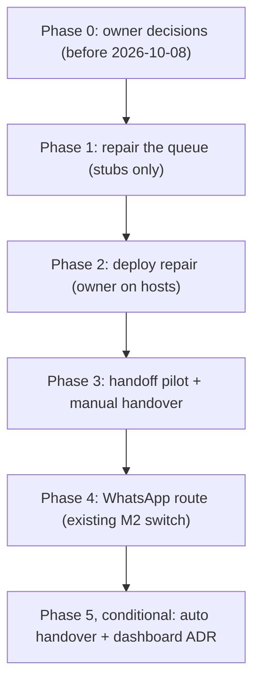

# Final plan: multi-CLI task runner (ADR-044 candidate)

- Date: 2026-10-02
- Status: final review by Opus 5.5 of Astra's plan (`2026-10-02-astra-task-runner-plan.OUTPUT.md`). This is the go/no-go document.
- Nothing is executed until the owner confirms Section 2.
- Chain: Sol proposal → Opus review → Astra plan → this file.

## 1. Verdict on Astra's plan

**Approve, with three trims.** Astra's corrections to the Opus review are right, and all of them are kept:

1. A missing "accepted" receipt is not proof that the task never started. The worker must *fence* the attempt (write a "rejected" tombstone under the same lock that start uses) before a retry is allowed.
2. Once a task is accepted, it is never re-run automatically, even after a known failed exit. A worktree cannot undo network calls or detached processes.
3. Execution is plain-only. Attaching to a shared OpenCode server is disabled, because a client timeout does not stop server-side work.
4. A strict scanner mode is needed. The current `verify_sanitization.py` has marker-line and filename exemptions that runtime queue files would slip through.

**Trims** (simplicity, AGENTS.md Section 5):

| Astra proposed | Trimmed to | Why |
|---|---|---|
| Full migration and rollback runbook (Section 5) | Short path first. The owner counts queue files; if there are no real jobs, migration is "stop timer, back up, deploy". The full runbook is used only if real jobs exist. | `STATUS.md:17`: the relay skill was never switched and no real worker run has passed, so the queue has likely carried only test jobs. **Owner must confirm with counts.** |
| Separate approved "release root" machinery | The existing installer copies a versioned set to `~/.local/lib/naquuuu/v1/`, and relay and worker refuse to talk if their protocol numbers differ. | Same safety, without new deployment concepts. |
| Quota/context automation inside M1 | M1 gets a manual `handover` command (deterministic checkpoint, then one successor). Percentage-triggered automation moves to Phase 5 and runs only when a CLI exposes verified usage data. | Astra itself found no verified quota or context telemetry for any of the three CLIs. |

Thresholds are recorded as policy now, so Phase 5 does not reopen them: quota checkpoint at 90% used and handover at 95%; context checkpoint at 80% and handover at 90%. Unknown data shows as `unknown`, never a guessed number. A new chat does not reset account quota.

## 2. Answers to Astra's five questions

Opus recommends. The owner confirms; blanks stay blank until then.

| # | Question | Opus recommendation | Owner answer |
|---|---|---|---|
| 1 | Host | **A.** `mipad-linux` runs jobs and is the standby relay, and the hub moves off the employer laptop before 2026-10-08. | ☐ |
| 2 | Pilot timing | **B.** Wait for `mipad-linux`. Phase 1 needs no host, so nothing is lost by waiting. | ☐ |
| 3 | Terms | Only the owner can answer. Real CLI runs stay disabled per CLI until the owner says yes for that CLI. | ☐ Codex ☐ Claude Code ☐ OpenCode |
| 4 | Scope cuts | **Yes.** No new dashboard (agent-viz is extended instead, Section 5), no account switching, text-only single-host pilot, AGY by hand. | ☐ |
| 5 | Technical go | **Yes**, with the three trims above. A yes allows Phase 1 only. Each later phase has its own gate. | ☐ |

## 3. Phases

| Phase | Who | Work | Done when |
|---|---|---|---|
| 0 | Owner | Answer Section 2. Sign in to the CLIs on `mipad-linux` yourself. Fix worker SSH trust (`scripts/authorize_worker.sh`). Move the hub off the laptop (ADR-043). | Section 2 filled in; `python scripts/host_check.py` readiness reported for the chosen host. |
| 1 | Builder (protocol core on a capable model; tests on `gpt-6-luna` / `deepseek-v4-flash` per ADR-041), verifier | Implement the repaired job queue protocol (M0): `dispatch_common.sh`; record-first dispatch; claim → accept receipt → finish receipt; fence before retry; worker-side timeout (1680 s agent, 10 s kill grace, relay 1800 s); plain-only runs; per-attempt evidence kept; `job_status.sh --counts-only`; strict scan mode; external worktrees on `codex/task/<id>`. | All Astra Section 3 fixture cases pass with stubbed `ssh`/CLIs; sanitization gate passes; no live host touched. |
| 2 | Owner runs, verifier reviews counts | Stop the drain timer, count and back up the queue, deploy the v1 set to relay then worker, run one synthetic job end to end. | One live synthetic job reaches `done` with a receipt; a forced disconnect after acceptance lands in `uncertain` with no second run. |
| 3 | Builder, then owner | v2 `.task` record; one adapter per CLI (Astra's verified flags); git bundle result package (text only, size-capped, strict-scanned); manual `handover <id> --to <cli>`; AGY rejected by the adapter. | Codex writes a task, Claude Code or OpenCode completes it, and the package verifies and merges on review. One manual handover mid-task keeps the full diff and starts exactly one successor. |
| 4 | Owner switch, existing runbook | Relay skill sends heavy jobs through the queue; one WhatsApp message on finish or failure (ADR-027 tone). | A WhatsApp request yields a traceable job and one completion message. |
| 5 | Later, separate approval | Threshold-triggered handover, only for a CLI with verified fresh usage data. A dashboard needs its own ADR. | Not scheduled. |

## 4. Rules that do not change

- No agent invokes or proxies `agy` (ADR-012). AGY tasks are briefs that the owner runs by hand.
- Commit, push and merge stay with the owner. Auto-sync never sees job worktrees, because they live outside every synced checkout.
- Tier 1 material, Hermes state and CLI auth files never enter task records or packages. The runner does not mechanically enforce privacy beyond the scanner (ADR-016).
- No rotating several accounts on one provider to evade limits.

## 5. Hermes dashboard and agent-viz

> **Superseded in part by `2026-10-02-task-runner-usability-plan.md`.** The job board moves into `naquuuu-term` (tailnet whois auth) as a board tab. agent-viz stays a private session-end review tool and is not served on its own tailnet port. The event-record items for Phase 1 and Phase 3 below still apply.

The cut "dashboard" stage is replaced by extending the existing visualizer. Nothing new is built inside Hermes.

| Surface | What it shows | Change |
|---|---|---|
| Hermes dashboard (`https://hermes-vps.tail317e88.ts.net/`, ADR-040) | Hermes itself: gateway, sessions, config | **None.** No verified plugin API, and the Hermes code is pinned. The WhatsApp completion message and the job record both carry the job ID, so you can match a Hermes session to a job by eye. ADR-040's owner checks (device login, off-tailnet refusal) are still open. |
| agent-viz (`scripts/render_agent_viz.py`, `.opencode/plugin/session-viz.js`) | Today: one OpenCode session, from `.session-viz/*.jsonl` | **Becomes the job view.** It shows one timeline per job across every CLI and any handover. |
| Job queue `events.log` (Astra Section 2) | State changes | **Writes viz-compatible records.** The builder confirms the record shape against `load_records` in the renderer. |

Changes by phase:
- **Phase 1:** `events.log` records use the session-viz JSONL shape, with the job ID as the session key and fields limited to state, CLI, attempt and reason codes.
- **Phase 3:** adapters convert each CLI's `--json` / `--format json` output into the same records, at runner level only: start, finish, handover, package. The renderer gains `--job <id>`. All strings pass through the renderer's existing `clean()` chokepoint.
- **Phase 4:** run `render_agent_viz.py --serve` on the VPS on loopback, published on a **separate** Tailscale Serve HTTPS port. No path sharing with Hermes and no Host/Origin rewrites, per the ADR-040 runbook. The page has no login of its own, so this step requires the drafted Tailscale ACL (`TAILSCALE_ACL.md`) to be applied first. Until then, view it from the laptop or worker over SSH port-forward only.

## 6. After owner sign-off

1. naquuuubot logs ADR-044 in `DECISION_LOG.md` with the Section 2 answers.
2. A Phase 1 brief goes to the builder, citing this file and Astra Sections 2–3 as the specification.
