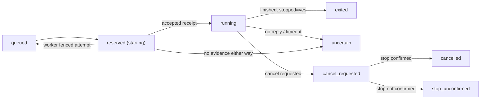
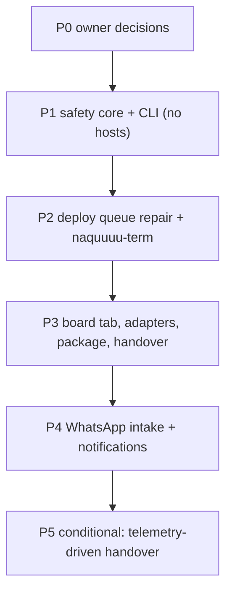

# Task runner and board: implementation plan (harness revamp)

- Date: 2026-10-02
- Author: Opus 5.5 (final consolidation)
- Status: **Proposed.** ADR-044 is not accepted. This turn authorizes review and drafting only. Implementation and deployment remain behind the owner gates in Section 9.
- Consolidates and supersedes, where they conflict:
  - `2026-10-02-task-runner-final-plan.md`
  - `2026-10-02-task-runner-usability-plan.md`
  - `2026-10-02-astra-task-runner-plan.OUTPUT.md` (still the detailed M0 specification; referenced, not copied)
- Owner constraints:
  - Revamp the **existing** naquuuu harness with established open-source capabilities, keeping its identity and operating rules.
  - No new tool subscription and no compulsory new model spend.

**Evidence labels used throughout:**

| Label | Meaning |
|---|---|
| **[D]** | Documented by an official source, fetched 2026-10-02 |
| **[V]** | Verified locally by reading repository code or config on 2026-10-02. Not a live-host check |
| **[P]** | Proposed, not built |
| **[O]** | Owner-gated rollout or decision |
| **pending** | Untested check |

## 1. The harness today

| Layer | Supplied by | Evidence |
|---|---|---|
| Agent runtime, sessions, context, tool use | **OpenCode** 1.18.32 on the VPS and `mipad-linux` | [V] `HOSTS.md:35-36` |
| Roles and orchestration (7 agents, `subagent_depth: 1`, per-agent models, permissions) | **OpenCode config**, with custom persona text | [V] `opencode.jsonc`, `.opencode/agent/*.md` |
| Permissions (bash allow, commit/push ask, destructive deny, Hermes state deny) | **OpenCode permission system**, configured by us | [V] `opencode.jsonc` |
| Slash commands, telemetry plugin | **OpenCode plugin and command API**, custom content | [V] `.opencode/command/`, `.opencode/plugin/session-viz.js` |
| Server API (sessions, async prompt, abort, status, todo, diff, SSE events, health, basic auth) | **OpenCode server** | [D] [server docs](https://opencode.ai/docs/server/) |
| Programmatic client (`createOpencodeClient`, `session.prompt/abort/children`, `event.subscribe`, structured output) | **OpenCode SDK** `@opencode-ai/sdk` | [D] [SDK docs](https://opencode.ai/docs/sdk/) |
| Editor protocol (`opencode acp`) | **OpenCode ACP** | [D] [ACP docs](https://opencode.ai/docs/acp/) |
| WhatsApp gateway, approvals posture, dashboard | **Hermes** (code pinned) | [V] ADR-016, ADR-026, ADR-040 |
| Relay skill (WhatsApp → `opencode run --agent …`) | Custom skill on Hermes | [V] `internal-docs/relay/OPENCODE_RELAY_SKILL.md`, ADR-027 |
| Job dispatch, durable queue, drain timer, status | **Custom** bash | [V] `scripts/dispatch_job.sh`, `drain_queue.sh`, `worker_exec.sh`, `job_status.sh` |
| Phone UI: terminal, agents world, workspace | **Custom** `naquuuu-term` (deployment pending) | [V] `projects/naquuuu-term`, ADR-032 |
| Session-end review | **Custom** agent-viz | [V] `scripts/render_agent_viz.py`, ADR-034 maintenance note, AGENTS.md §5 |
| Gates (sanitization, hooks, multi-repo audit) | **Custom** | [V] `scripts/verify_sanitization.py`, `.githooks/` |

**Gaps no current layer fills:**
- safe execution identity: receipts, fencing, no replay;
- scope locks;
- portable result packages;
- cross-tool handover;
- a "what needs me" view;
- completion notifications.

## 2. Foundation decision

**Decision [P]: keep OpenCode as the foundation, Hermes as the messaging gateway, and `naquuuu-term` as the UI.** The task runner is a thin, durable layer on top. It is built from OpenCode's server and SDK and the existing queue scripts, not a new framework.

### Alternatives evaluated

| Candidate | License | Model access | Persistence | Resources | Verdict |
|---|---|---|---|---|---|
| **OpenCode** (current) | MIT [D] (GitHub `anomalyco/opencode`) | Already configured with `opencode-go` models (existing spend, ADR-015) [V] | Local session storage; documentation does not specify location [D] | Already running on both hosts [V] | **Keep.** Its server, SDK and events cover session control, abort, structured events, todo and diff. Its config already encodes the 7 roles and permissions |
| **DeepSeek Harness** (`dsh`) | MIT [D] (GitHub API) | Not documented in the README; unverified | Unverified | Node; web UI on 3080 [D] | **Reject as foundation.** README: "developer preview… THERE WILL BE COMPATIBILITY-BREAKING CHANGES" [D]. It would replace the OpenCode roles and permissions we already rely on, and provides no queue, receipt or board features |
| **OpenHands Agent Canvas** | MIT [D] (GitHub API) | Bring-your-own model; supports Claude Code, Codex and ACP agents [D] | Conversation history persists via workspace and containers [D] | Node 24+, `uv`, Docker container per conversation [D] | **Reject as foundation; note as a future option.** Docker per conversation does not fit the 2 GB VPS. It duplicates `naquuuu-term` and offers no receipt or fencing contract. Revisit only if a full multi-agent control center becomes a goal |
| **OpenDots** (CopilotKit) | MIT [D] | OpenAI-compatible provider [D] | Local workspace DB plus CopilotKit Threads [D] | Unmeasured | **Reject.** A Slack, voice and chat co-worker template; it is not a coding task runner |
| **OpenMuse** (CopilotKit) | MIT [D] | Requires `CPK_INTELLIGENCE_API_KEY` plus a provider key [D] | PGlite or PostgreSQL in `.openmuse/` [D] | Playwright, Chromium, optional Docker [D] | **Reject.** Needs a CopilotKit project key. The free tier is limited to 3-day thread retention, 200 threads and 1 GB [D] ([pricing](https://www.copilotkit.ai/pricing)), and self-hosting the database is on the $100/seat Team tier [D]. That violates "no new subscription" and durable storage |

Free source code does not mean free execution. Every candidate still needs a paid or quota-limited model. The only no-new-spend path is the models the owner already pays for: `opencode-go`, and the existing Codex and Claude plans if the terms question (Q3) is answered yes.

### Component replacement map [P]

| Current custom piece | Replaced by | Keep custom |
|---|---|---|
| `worker_exec.sh` attach→plain fallback and stdout capture | **OpenCode adapter on a per-attempt `opencode serve`** (loopback, random port, ephemeral password held in memory) driven by the SDK. `session.prompt` per bounded step, `session.abort` and process-group stop, `event.subscribe` for the timeline, `GET /session/:id/diff` and `/todo` for the package | Supervisor, receipts, timeout and kill of the server process. *M0 uses plain `opencode run --format json` first; the per-attempt server arrives in Phase 3 behind a flag.* |
| Shared-server attach for jobs | Removed (Astra §2). The interactive shared server on the VPS stays only for the agents tab | — |
| Ad hoc per-CLI invocation | Thin adapters: OpenCode (SDK), Codex (`codex exec … --json`), Claude (`claude -p --output-format json`), flags per Astra §4 [D] | Normalising to four-block results and events |
| `job_status.sh` raw output | `naquuuu-task snapshot --json` (Section 5.3) | Yes (new) |
| agent-viz as a live job view | Not used for live jobs (correction below) | It optionally reads job events for after-the-fact review |
| Workspace permissions | OpenCode `permission` blocks per agent [V] | — |

**Minimum custom code still required [P]:**

1. Hub `scripts/`:
   - `dispatch_common.sh`;
   - repaired `dispatch_job.sh`, `drain_queue.sh` and `worker_exec.sh` (start / status / fence / stop);
   - installer `--no-start`;
   - `verify_sanitization.py` strict stream mode;
   - `naquuuu_task.py`, the `naquuuu-task` CLI (Python 3 stdlib): `board`, `show`, `snapshot`, `reconcile`, `cancel`, `new`, `handover`, `review`, `integrate`;
   - `task_adapter` modules (OpenCode SDK, Codex, Claude);
   - the package builder;
   - fixtures.
2. `projects/naquuuu-term`:
   - `server/board.js` (snapshot poller and `/ws/board`);
   - `server/action.js` (allowlisted action PTY);
   - allowed-tags configuration in `auth.js`;
   - the board view in `public/` (`app.js`, `index.html`, `style.css`);
   - tests.
3. Hermes relay skill:
   - intake via `naquuuu-task new`;
   - notifications via the existing outbound path (`scripts/relay_outbound.py`, contract to verify).

### Policies that do not change

- AGENTS.md tiers and the Model-Input Boundary.
- ADR-012: AGY is human-operated, and nothing invokes or proxies `agy`.
- ADR-016: autonomy posture, plus the commit/push ask.
- ADR-025: auto-sync. Jobs stay outside synced roots.
- ADR-027 / ADR-034: WhatsApp tone and bounded turns.
- ADR-040: the Hermes root route.
- ADR-041: cost routing.
- ADR-043: the laptop has no relay role.
- Owner-only integration.
- No rotating several accounts on one provider.

## 3. Task-safety contract

The framework is not the safety mechanism. OpenCode `abort` and any retry or cancel feature are inputs to these rules, not proof that the rules hold.

### 3.1 Identity

- A task is identified by `task_id`, an immutable admitted payload with `task_sha256`, and an append-only event history in the queue.
- Native CLI conversation IDs are **never** authoritative. A worker may keep them in local attempt metadata as opaque hints. They are excluded from the board, packages and WhatsApp.
- Handover carries the checkpoint package (base, diff, results, remaining work), never a transcript.

### 3.2 State model: four independent dimensions plus "unknown"



| Dimension | Values | Notes |
|---|---|---|
| **Execution** | `queued`, `reserved`, `running`, `exited(rc)`, `uncertain`, `cancel_requested`, `cancelled`, `stop_unconfirmed`, `blocked_admission` | **`reserved` (the old "claimed") means reserved or starting. It does not mean execution began.** Only an `accepted` receipt means `running`. |
| **Attempt outcome (worker)** | `fenced` (worker refused this attempt and wrote a tombstone), `refused_invalid` (bad input / base / protocol), `accepted`, `finished` | Worker-side only. **Never called "rejected".** |
| **Result** | `none`, `packaging`, `package_valid`, `package_invalid(reason)`, `package_missing` | Invalid means a scan failure, path outside scope, binary content or a manifest mismatch. This is an automated check, distinct from owner review. |
| **Review / integration** | `unreviewed`, `owner_rejected`, `approved_unintegrated`, `integrated` | `approved_unintegrated` is shown until the merge lands. If the destination base moved, the card says "needs re-check before merge". |
| **Handover** | `none`, `requested`, `source_stopping`, `checkpointed`, `successor_admitted`, `blocked(reason)` | `blocked` reasons: `source_not_stopped`, `checkpoint_unsafe`, `no_eligible_destination`, `terms_unconfirmed`. |
| **Unknown** | `unknown(reason)` | Used whenever records are missing, contradictory or unreadable. It is never mapped to a guessed state. |

### 3.3 Rules

1. **Durable admission first.** Every path writes the scanned record before any execution, including WhatsApp, `naquuuu-task new` and the old `--local` path.
2. **Scope locks.** One writer per repository scope (Astra §2). A lock is held from `reserved` until stop is proven. Active brief `.lock` files block admission conservatively.
3. **No automatic replay after acceptance.** This holds for every exit code, timeout and transport error. Only a positively fenced pre-acceptance attempt may return to `queued`.
4. **Reconciliation needs stop evidence before releasing scope or allowing another attempt.** Acceptable evidence is either:
   - (a) a valid `finished` receipt with `process_group_stopped: yes`; or
   - (b) `naquuuu-task reconcile` querying worker `status`, which reports no live process for the attempt's process group (and, for the OpenCode adapter, the per-attempt server process is gone).

   Without that evidence the job stays `uncertain` / `stop_unconfirmed`. An owner attestation is recorded as `owner_attested_stop` with a timestamp. It is allowed, but labelled as such, never as verified.
5. **Cancellation:**
   - `queued` → cancelled under the queue lock (never started).
   - `reserved` → fence first: a fenced attempt becomes `cancelled`; an accepted one moves on to the `running` rule.
   - `running` → stop request, then `cancel_requested` until stop evidence arrives. After that comes `cancelled`, or `stop_unconfirmed` after the kill grace.
   - Cancel is idempotent and never reruns anything.
6. **Handover** requires source stop evidence (rule 4) before the successor is admitted. Exactly one successor; no third-tool fallthrough (Astra §4).
7. **Packages** are sanitized and text-only in M1. The owner integrates; `integrate` prints or performs the merge only after an explicit confirmation.

## 4. Board: where it lives and what "home" means

- **Placement [P]:** a `board` tab inside `naquuuu-term`. No evaluated foundation offers a board that meets these workflows and the auth model (Section 2).
- **Independence:** the board is a separate server module (`server/board.js`) on its own WebSocket channel (`/ws/board`). It works when the OpenCode observer behind the agents tab is offline, and the agents tab works when the queue is offline.
- **Home vs default, resolved:** the app still **opens on the terminal**, because ADR-032 exists for out-of-band recovery and the kill switch must be one tap away. The board is the home *for jobs*: the tab bar shows `term · board · agents · space`, and the board tab carries a Needs-you count badge. A per-device setting ("open on: terminal / board") defaults to terminal.
- **Five lifecycle categories stay:** Needs you, Review, Running (includes "Starting" = `reserved`), Waiting, Finished. The mapping from Section 3.2 is in the label table (5.4).

## 5. Board implementation contract

### 5.1 Command-draft path (replaces "prefill the PTY")

**Fact [V]:** `public/app.js:609-611` (`intoShell`) sends `text + "\n"` to the user's interactive PTY, so it executes immediately. The server closes the PTY when the socket closes (`server/index.js:208-215`). Board actions must not use that path.

**Proposed flow [P]:**

1. **Preparing an action sends nothing.** Tapping a card's action opens the sheet with a **draft**: verb, tag, a plain description of the effect, and the exact argv shown as text. The draft lives in client memory and `sessionStorage` (wrapped in try/catch). No socket message is sent.
2. **Submission is explicit.** The "Run in action terminal" button is enabled only while `/ws/board` is open and authenticated. Pressing it sends `{type:"action", verb, tag, nonce}` once.
3. **Server validation.** The verb is checked against an allowlist (`reconcile`, `cancel`, `handover`, `review`, `integrate`, `show`). The tag must match `^T-[0-9a-z]{4,12}$`. A nonce seen in the last 10 minutes is ignored; the server replies `duplicate` and starts nothing.
4. **The server spawns a new, dedicated action PTY**, never the owner's interactive one. It uses argv `["naquuuu-task", verb, tag, "--confirm"]`, with no shell string. This means:
   - it **cannot** concatenate with a half-typed command;
   - it **cannot** feed a running TUI.

   The client shows it in an "action" pane. `naquuuu-task` prints exactly what it will do, then asks `Proceed? [y/N]`. **The owner types `y`.** The pre-confirmation phase is read-only.
5. **Disconnected:** the button is disabled and shows "Not connected — draft kept, nothing sent". On reconnect **nothing is re-sent**: there is no client-side outbox. If the socket drops after submit, the sheet shows "Sent; result unknown — check the card". The card's state comes from the next snapshot, and the action itself is idempotent (rule 5; handover has a transition ID).
6. **Limits:** the action PTY counts toward `NQ_MAX_SESSIONS` (4) [V]. At the limit the sheet says "Too many terminals open — close one". Nothing is queued.
7. **Out of scope, flagged:** the workspace tab's existing `intoShell` should also stop sending `\n`. This is a separate small fix in `naquuuu-term`.

### 5.2 Why `job_status.sh` cannot be the data source [V]

- `count_jobs` prints `0` for a missing directory (`job_status.sh:29-36`), and `find … 2>/dev/null` hides read errors. "Missing" or "unreadable" therefore look the same as "no jobs".
- It prints `completed.log` lines and the newest `done/*.out` **body** (`:44-66`).
- It is kept only as a legacy CLI. `naquuuu-task snapshot --json` replaces it as the board's data source.

### 5.3 Snapshot and detail contract [P]

**Summary** (`naquuuu-task snapshot --json`, run on the VPS by `server/board.js` with a 5 s `execFile` timeout, only while at least one board client is connected):

```json
{
  "schema": "naquuuu.board.v1",
  "generated_at": "2026-10-02T09:00:00Z",
  "source": { "queue": "ok|missing|unreadable", "worker": "reachable|unreachable|unknown" },
  "counts": { "needs_you": 0, "review": 0, "running": 0, "waiting": 0, "finished_7d": 0 },
  "jobs": [ {
    "tag": "T-4821", "title": "≤60 chars", "repo": "slug", "cli_chain": ["codex", "claude"],
    "category": "needs_you|review|running|waiting|finished",
    "label": "Check needed", "status_line": "≤140 chars", "reason_code": "uncertain_no_reply",
    "age_s": 0, "elapsed_s": null, "budget_s": null,
    "usage": { "quota": { "value": null, "source": null }, "context": { "value": null, "source": null } },
    "action": { "verb": "reconcile", "label": "Check it" }
  } ],
  "truncated": false
}
```

- **Bounds:** at most 200 jobs, and Finished limited to 7 days and 50 jobs. Strings are length-capped and pass the strict scanner. There are no bodies, prompts, paths outside repo-relative, IDs beyond the task tag, or account data.
- **Detail** (`naquuuu-task show <tag> --json`): up to 100 newest timeline events (plain sentence plus reason code), the four-block result capped at 4 KB per block, and up to 100 changed file names. Same scanning applies.

**The board distinguishes four data conditions:**

| Condition | Detection | Board shows |
|---|---|---|
| Valid empty | `source.queue == "ok"` and `jobs == []` | Per-column empty text ("Nothing needs you.") |
| Unavailable | `source.queue` is `missing` or `unreadable`, or the generator fails or times out | Error header "Queue unreadable"; last good cards kept and dimmed, marked stale; **never** the empty text |
| Unsupported schema | `schema` is not a known version | "Board needs an update"; no cards rendered |
| Stale | Snapshot age > 2 × poll interval | Banner "Board may be out of date"; cards kept |

**Freshness rule:** age is computed from `generated_at`, using the **server's** clock. `board.js` sends `{snapshot, server_now}`, and the client adds its own monotonic elapsed time since delivery. That avoids phone clock skew.

### 5.4 Label mapping (shared by board, CLI and WhatsApp)

| Category | Labels |
|---|---|
| Needs you | Check needed (`uncertain`, `unknown`); Stop not confirmed; Failed (`exited` with rc≠0); Result rejected by checks (`package_invalid` / `package_missing`); Can't hand over (`handover blocked`); Your AGY task; Blocked (`blocked_admission`) |
| Review | Ready for review (`package_valid`, `unreviewed`); Approved, not merged (`approved_unintegrated`) |
| Running | Starting (`reserved`); Running on <CLI> (`running`); Cancelling (`cancel_requested`); Handing over (`source_stopping` / `checkpointed`) |
| Waiting | Worker offline; Waiting for quota reset; Waiting for <title> (scope lock) |
| Finished | Merged (`integrated`); You rejected it (`owner_rejected`); Cancelled |

Worker fencing never appears as "rejected". "You rejected it" is reserved for the owner.

### 5.5 Phone usability and accessibility (corrected targets)

- **Two-tap target, made consistent:** from the **board tab**, a Needs-you item's action draft is at most 2 taps away (card → action). From a cold open on the terminal it is 3 taps (board tab → card → action). *pending*
- **Replacing "five full cards on one screen":** on phones the Needs-you section renders **compact rows** (one-line title plus one-line label, 44 px minimum height), with details in the sheet. Target: 5 compact rows visible without scrolling at 360×640 CSS px. *pending* (measure; not a promise for long titles or 200% text).
- **Sheet:**
  - `role="dialog"`, `aria-modal="true"`, labelled by the title;
  - focus moves into the sheet and is trapped there; Esc and Back close it, and focus returns to the card;
  - background scroll is locked;
  - on phones, a bottom sheet capped at 90 vh with internal scroll; on desktop (≥ 900 px, the existing breakpoint), a side panel.
- **Text:** titles wrap (no ellipsis-only truncation on the sheet). Tags, paths and commands use `overflow-wrap: anywhere` in mono. No horizontal overflow at 320 px.
- **Zoom:** usable at 200% browser zoom and with the OS large-text setting. Layout uses rem and min/max sizing, with no fixed-height text containers.
- **Motion:** 150 ms column transitions; none under `prefers-reduced-motion` (the existing rule [V] `style.css:608`). No spinners after first load.
- **Touch targets:** at least 44 px (`--key-h` [V]), with at least 8 px between adjacent actions.
- **Colour:** the single `--accent` is used only for Needs you. Every state has a text label plus an icon. Contrast is checked to AA on `--bg-card`.
- **Screen reader:** cards read as "title, label, action". Only changes to the Needs-you count are announced (polite).

## 6. Deployment and policy corrections

1. **ADR-032 is accepted, with deployment pending.** The auth code is not evidence of deployed access. Every access claim stays *pending* until the Phase 2 checks run.
2. **HTTPS endpoint must not overwrite the Hermes root.** ADR-040 serves `https://hermes-vps.tail317e88.ts.net/` → `127.0.0.1:9119`. The `naquuuu-term` README and `NQ_TERM_RUNBOOK.md` instruct `tailscale serve --bg http://127.0.0.1:7777`, which targets the default HTTPS port, so it can collide. **Superseded:** use `tailscale serve --bg --https=8443 http://127.0.0.1:7777` [D] (flag syntax from the Tailscale docs; coexistence with the 443 route is **not documented** and is checked in Phase 2 with `tailscale serve status` before and after). Both docs get a superseded note in Phase 2. The ACL grant changes from `tag:personal:443` to `tag:personal:8443`.
3. **Personal laptop access.** `auth.js` requires one tag (`NQ_REQUIRED_TAG`, default `tag:phone`) [V]. Proposed [P]: `NQ_ALLOWED_TAGS` (comma-separated; `tag:phone` stays the default). The owner tags the *personal* laptop, e.g. `tag:owner-desktop`, and adds the matching ACL grant. **The employer-managed laptop is never tagged** (ADR-043), so it stays denied. Until then, the laptop uses the CLI over SSH, not the board.
4. **OpenCode servers:**
   - The VPS shared `opencode serve` (127.0.0.1:4096) stays for interactive sessions and the agents tab (ADR-032).
   - Worker jobs never attach to it. They use plain runs (M0) or per-attempt servers on the worker (Phase 3).
5. **Resources: measure, do not assume.** The VPS is 2 vCPU / 2 GB [V]. Phase 2 records `free -m` and per-unit `MemoryCurrent` for the Hermes gateway, `opencode-serve` and `naquuuu-term` in three conditions:
   - idle;
   - one board client polling for 10 minutes;
   - one action PTY open.

   The proposed owner threshold to go live is MemAvailable at least 25% and no growth in swap use. It is a policy number, not a measurement. *pending*
6. **WhatsApp:** job titles are the default. Task tags in WhatsApp need an explicit ADR-027 clarification first [O].
7. **agent-viz reference corrected:** its role comes from the **ADR-034 knowledge-maintenance note** and **AGENTS.md §5** (session-end `/agent-viz --serve`, sanitized explicit exports). It is not ADR-033. The usability plan's ADR-033 citations are superseded by this line.

## 7. Phases, tasks and rollback



| ID | Task | Phase | Owner/role | Depends on | Repo |
|---|---|---|---|---|---|
| T1 | State model, schemas (`task v2`, receipts, `board.v1`), label table | P1 | Capable model (orchestrator) | P0 | hub |
| T2 | `dispatch_common.sh`, record-first dispatch | P1 | Capable model | T1 | hub |
| T3 | Worker `start/status/fence/stop`, supervisor, timeouts, stop evidence | P1 | Capable model | T1 | hub |
| T4 | Drain claim / reserve / reconcile / `--hold-legacy` | P1 | Capable model | T2, T3 | hub |
| T5 | Strict scan stream mode | P1 | Builder (flash) | T1 | hub |
| T6 | `naquuuu-task`: board, show, snapshot, reconcile, cancel (all `--json`) | P1 | Builder (flash) | T1, T4, T5 | hub |
| T7 | Fixtures: Astra §3 + cancel paths + snapshot conditions + canaries | P1 | Builder, then verifier (flash) | T2–T6 | hub |
| T8 | Installer `--no-start` and computed unit budget | P1 | Builder | T2–T4 | hub |
| T9 | Deploy queue repair (Astra §5 short path if counts show no real jobs) | P2 | Owner | T7, T8 | hosts |
| T10 | Deploy `naquuuu-term` on `:8443`, ACL grant, verify the Hermes root is intact | P2 | Owner | P0 | hosts |
| T11 | Resource measurement (6.5) | P2 | Owner, verifier reads numbers | T10 | hosts |
| T12 | Live synthetic job, interruption and cancel tests | P2 | Owner | T9 | hosts |
| T13 | `board.js`, `/ws/board`, board view, sheet, accessibility | P3 | Builder | T6, T10 | naquuuu-term |
| T14 | `action.js` action PTY, nonce dedupe; `NQ_ALLOWED_TAGS` | P3 | Capable model (security) | T10 | naquuuu-term |
| T15 | Adapters: OpenCode SDK per-attempt server (flagged), Codex, Claude | P3 | Builder; terms gate per CLI | T3, Q3 | hub |
| T16 | Package builder, `review`, `integrate --confirm` | P3 | Capable model | T15 | hub |
| T17 | Manual `handover` | P3 | Capable model | T16 | hub |
| T18 | Relay skill: `naquuuu-task new`, 4 notifications, "what needs me" | P4 | Builder | T12, T13 | hub |
| T19 | ADR-027 clarification (only if tags are wanted) | P4 | naquuuubot | owner | hub |
| T20 | Usage telemetry per CLI | P5 | — | verified source | hub |

- **Parallelism:** T2/T3 serialize (shared protocol). T5 runs in parallel with T2–T4. T13 and T14 are in a different repo and can run in parallel with T15–T17.
- **Workflow:** each P1 author task gets a skeptic review, then verifier gates (AGENTS.md §4), with at most 2 cycles.

**Rollback per phase:**

| Phase | Rollback |
|---|---|
| P1 | Revert the commits. No hosts were touched. |
| P2 queue | Astra §5 held rollback: never restore an old queue snapshot over current state; keep `.task`, reserved and uncertain jobs held. |
| P2 `naquuuu-term` | `tailscale serve --https=8443 off`; stop `naquuuu-term.service`; check that the Hermes root still answers `auth_required: true`. |
| P3 | Board and actions behind `NQ_BOARD=0` and `NQ_ACTIONS=0`; adapters behind a per-CLI enable list; `.task` admission off. Records are never downgraded. |
| P4 | The relay skill reverts to direct `opencode run`. Notifications off. Queued jobs remain visible on the board. |

## 8. Acceptance checks

All checks below are **pending**. None has run.

| Area | Check | Where |
|---|---|---|
| J1 start once | Task submitted by WhatsApp and by `naquuuu-task new` appears as Starting or Waiting within one poll; no repo path typed and no context pasted | P3/P4 |
| J2 what needs me | From the board tab: the count badge is visible; compact rows meet the 5.5 target at 360×640 | P3 |
| J3 switch tools | `handover` keeps the cumulative diff, shows "Codex → Claude", starts exactly one successor, and only after stop evidence | P3 |
| J4 review / integrate | Review sheet shows the four-block result, gates and files; `integrate --confirm` requires `y`; approved-unmerged is shown until merge | P3 |
| J5 recover | An uncertain job is settled via `reconcile` using only on-screen text; scope is not released without stop evidence | P2/P3 |
| J6 AGY | Brief card opens the brief path; no process invokes `agy` (PATH sentinel); the owner's commit moves it to review | P3 |
| Interruption | Kill the drain after reserve; drop transport after accept; reboot the worker mid-run → no second model start, state `uncertain` / `stop_unconfirmed` | P1 fixtures, P2 live |
| Duplicate prevention | Double-tap Run, reconnect storm, same nonce twice, concurrent drains → at most one action PTY and at most one model start | P1/P3 |
| Cancellation | Cancel while queued / reserved / running / not stopping → cancelled, fenced-then-cancelled, cancel_requested → cancelled, and stop_unconfirmed, respectively | P1/P2 |
| Draft safety | Opening a draft sends no socket message; a half-typed terminal command stays untouched; a TUI in the main PTY receives nothing; offline submit is disabled; reconnect sends nothing | P3 |
| Snapshot conditions | Empty, missing, unreadable, unsupported-schema and stale snapshots each render their distinct state; never empty-on-error | P1 (CLI), P3 (UI) |
| Privacy canaries | Synthetic secrets in task text, output, result, file content, events and snapshot → refused or redacted; nothing reaches board, WhatsApp, logs or package | P1/P3 |
| Phone usability | 320 px no overflow; 44 px targets; 200% zoom; reduced motion; keyboard and screen-reader pass of card → sheet → action | P3 |
| Access | Phone allowed; tagged personal laptop allowed; untagged and employer laptop denied; off-tailnet denied; Hermes root unchanged | P2/P3 |
| Resources | 6.5 measurements recorded and meet the owner threshold | P2 |
| No new spend | No new account, subscription or hosted DB; model calls only through existing configured providers | All |

## 9. Owner decisions (unresolved; none assumed)

1. **Host (Q1).** `mipad-linux` as the worker and standby relay; hub placement before 2026-10-08 (ADR-043).
2. **Pilot timing (Q2).** Recommended: wait for `mipad-linux`.
3. **Terms (Q3).** Per CLI (Codex, Claude Code, OpenCode provider) before its adapter is enabled.
4. **Scope (Q4).** No new dashboard, no account switching, text-only single-host pilot, AGY by hand.
5. **Technical go (Q5).** Phase 1 only.
6. **New: tailnet access.** Serve port `8443`; the ACL grant; whether to tag a personal laptop (`NQ_ALLOWED_TAGS`), and which device.
7. **New: resource threshold.** Accept the 25% MemAvailable go-live rule, or set another.
8. **New: per-attempt OpenCode server (T15).** Adopt it in Phase 3 behind a flag, or stay on `opencode run --format json`.
9. **New: WhatsApp tags.** Titles only, or clarify ADR-027 for task tags.

After sign-off: naquuuubot logs ADR-044 with these answers, then issues the P1 brief (T1–T8) using this file plus Astra §2–§3 as the specification.
