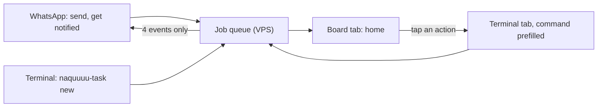

# Usability plan: multi-CLI task runner and kanban board

- Date: 2026-10-02
- Status: draft by Opus 5.5, for review by Sol 6.1 or Fable. Planning only; nothing is built or deployed.
- Builds on: `2026-10-02-task-runner-final-plan.md` (phases, job lifecycle), Astra's plan (`…astra-task-runner-plan.OUTPUT.md`), ADR-027 (WhatsApp tone), ADR-032 (`naquuuu-term`), ADR-040 (Hermes dashboard).
- Correction to the final plan, Section 5: it put a job view on agent-viz served on its own tailnet port. That page has no login. `naquuuu-term` already has tailnet identity auth (whois + `tag:phone`, fail-closed), is mobile-first, and runs on the VPS where the queue lives. **The board belongs in `naquuuu-term` as a fourth tab.** agent-viz goes back to its ADR-033 role: private session-end review and sanitized exports.

## 1. The problem in the owner's words

"I describe a task once, follow it anywhere, and switch tools without rebuilding context." Today the owner:
- re-explains context when moving between Codex, Claude Code and OpenCode;
- has no single place that answers "what needs me right now?";
- gets no reply when a queued job finishes (`STATUS.md:17`);
- has five possible screens: WhatsApp, terminals, the Hermes dashboard, agent-viz, and `naquuuu-term`.

## 2. One home, clear roles

| Surface | Role | Owner does here |
|---|---|---|
| **Board tab in `naquuuu-term`** | **Home.** Every job and its state, on phone or laptop | Glance, open a job, launch the next command |
| WhatsApp | Push and quick intake | Send a task; get the 4 notifications in Section 6; ask "what needs me?" |
| `naquuuu-term` terminal tab | Doing | Run `naquuuu-task` commands, review diffs, run AGY by hand |
| Hermes dashboard (ADR-040) | Hermes administration only | Gateway, sessions, config. No job data |
| agent-viz (`render_agent_viz.py`) | After-the-fact review | Session-end review and sanitized exports (ADR-033). Not live |



**Rule:** the board shows state but owns none. It reads the queue through a sanitized machine-readable status export and never writes to it. In v1 every action is a command prefilled into the terminal tab; the owner presses Enter. Nothing on the board changes a job by itself.

## 3. Kanban board

### Columns

Columns are derived from queue state plus review state. On a desktop they read left to right in urgency order. On a phone they stack top to bottom as sections, with no horizontal scrolling (AGENTS.md 6A, 320 px).

| Column | Contains (internal state → plain label) | Empty state text |
|---|---|---|
| **Needs you** | `uncertain` → "Check needed"; `failed` → "Failed"; handover blocked → "Can't hand over"; AGY brief waiting → "Your AGY task"; refused at admission (brief lock, terms, scan) → "Blocked" | "Nothing needs you." |
| **Ready for review** | `done` + `unreviewed` → "Ready for review" | "Nothing to review." |
| **Running** | `claimed` / `accepted` → "Running on <CLI>" | "Nothing running." |
| **Waiting** | `pending` with its reason: "Worker offline", "Waiting for quota reset", "Waiting for <job title> to finish" (scope lock) | "Queue is empty." |
| **Finished** | `integrated` / `rejected`, last 7 days, collapsed by default | "No finished jobs this week." |

Internal words (`claimed`, `fenced`, `uncertain`) never appear as card labels. They are visible only in the job timeline, for debugging.

### Card anatomy

1. Title: the task goal, 60 characters at most.
2. Repo slug and CLI chain, for example "Codex → Claude Code" after a handover.
3. One plain-language status line, for example "The worker went quiet after starting. Check it before anything reruns."
4. Age, and for Running cards elapsed time against the time budget.
5. Quota and context on Running cards: a value with its source, or "unknown". Never an estimate (ADR-032 item 7 applies here too).
6. One primary action. It prefills the terminal tab with the exact command, for example `naquuuu-task review T-4821`.
7. A "timeline" link: the job's event history, showing which CLI, attempt, handover, receipts and reason codes.

### Visual rules

- State is never encoded by colour alone. Every card carries a text label and an icon shape.
- Follow ADR-032 item 10: the culture palette, with its three-colour cap. Urgency is shown by column position, type weight and opacity, not new hues.
- Honour `prefers-reduced-motion`. The agents tab's pixel world is separate and stays as is.
- Count changes are announced politely to screen readers (`aria-live="polite"`). All controls can be reached by keyboard.

### Freshness and failure

- The header shows "updated Ns ago".
- After two missed refreshes, a banner says "Board may be out of date" and offers a reload. A stale board never looks current.
- If the queue cannot be read, the board shows an error, never an empty board. "Queue unreadable" and "nothing to do" must look different.
- The refresh interval is a configuration choice. Start at 10 s and tune from use; it is not a measured requirement.

## 3b. UI/UX specification (board tab)

Grounded in the existing app (`projects/naquuuu-term/public/index.html`, `style.css`). The board is a peer of the current tabs and reuses their tokens; it does not get its own design system.

### Placement and navigation

- The tab bar becomes `term · board · agents · space`. The board goes second, so it is one tap from the terminal. Labels stay lowercase, matching the existing tabs.
- The tab badge reuses the `tab-badge` pattern from the agents tab and shows the **Needs you** count. It is hidden at zero. The badge is the only thing on the board that draws attention when the owner is on another tab.
- The bookmark opens on the terminal tab, as it does today. On first use, a dismissible hint points to the board, then never shows again (the dismissal is stored per device in `localStorage` and wrapped in try/catch).
- The selected tab and expanded columns persist per device. If storage fails, the default view is used.

### Layout

| Viewport | Layout |
|---|---|
| Under 900 px (phone; existing breakpoint) | One scrolling list of sections in urgency order. Each section header is a sticky row with label and count. Waiting and Finished collapse by default when they hold more than 3 cards. No horizontal scrolling, ever. |
| 900 px and wider | Five columns side by side, each scrolling on its own within the view height. The card list keeps the 72ch measure for detail text. |
| Phone landscape, height ≤ 480 px (existing media query) | Same as phone, with headers not sticky so content keeps the space. |

### Card and detail interaction

- **Tap a card** to open a bottom sheet on phone or a right-side panel on desktop. Opening it does not change the route; Back and Esc close it.
- **Sheet contents, top to bottom:**
  1. Title and plain status line.
  2. Primary action button.
  3. "What happened": the timeline, newest first, with plain sentences and the raw reason code in muted mono.
  4. Result summary (four-block) when present.
  5. Files changed (names and counts only; the diff stays in the terminal).
  6. Full task tag and IDs, collapsed at the bottom.
- **Primary action:** tapping "review" switches to the terminal tab and types `naquuuu-task review T-4821` **without pressing Enter**. A one-line toast says "Command ready — press Enter to run". The owner always runs it.
- **No long-press or swipe gestures** in v1. Every action is a visible button at least 44 px high (the existing `--key-h`).
- The sheet has no secondary destructive action. `cancel` is reachable from the timeline, prefilled the same way.

### Visual language (ADR-032 item 10)

- Reuse the existing tokens: `--bg-surface` columns, `--bg-card` cards, `--border-subtle` hairlines, `--text-secondary` metadata, `--mono` for tags and commands, `--sans` for text.
- **One accent only.** `--accent` (terracotta crimson) is used only for Needs you: a 3 px left rule on the card and the count badge. Every other column uses the neutral palette. Urgency comes from position, weight and that single accent, so no new hues are added.
- Status icons are outline icons paired with text labels (check needed, failed, your AGY task, ready, running, waiting). The shape plus label carries the meaning; colour is a third cue, never the only one.
- Running cards show a thin progress line for elapsed time against the time budget. It is labelled "12 of 28 min", and it is a time budget, not task progress. No percent-complete is ever shown, because none is known.
- Quota and context show as `unknown` in muted text until Phase 5 provides a verified source. The source is named next to the value when one exists ("from opencode").
- The app is dark-first, like the rest of `naquuuu-term`. Text contrast is checked against `--bg-card` to WCAG AA. `--text-muted` (#b58287) is used only for non-essential hints and needs a contrast check on cards before use.

### Motion and feedback

- A card moving between columns gets one 150 ms fade/slide. `prefers-reduced-motion` (existing rule) makes it instant.
- No spinners on the board. Loading shows skeleton cards on the first load only; later refreshes update in place.
- Header states: "updated Ns ago", then "Board may be out of date · reload", then "Queue unreadable · details". These are three visually distinct states (Section 3, Freshness).
- Screen readers: column counts are announced politely only when Needs you changes, not on every refresh.

### Microcopy rules

- Speak about the job, not the system: "The worker went quiet after starting", not "receipt missing".
- Every status line ends with what to do, or with "Nothing to do".
- Use the same words everywhere: the board, `naquuuu-task board` and WhatsApp share one label table (Section 3).
- Use sentence case. The tab label is lowercase like its neighbours.

### UI acceptance (walkthrough, not metrics)

1. At 320 px wide there is no horizontal overflow, and every button is at least 44 px high.
2. A Needs you item can be found and its action prefilled in at most two taps from opening the bookmark.
3. With network off, the stale banner appears and the old cards stay visible.
4. A queue read error shows the error state, never "Nothing needs you".
5. A keyboard-only pass on the laptop reaches every card, the sheet and its action.
6. A screen-reader pass reads each card as "title, status, action".
7. In reduced-motion mode no element animates.

## 4. The `naquuuu-task` command

This is one command for the terminal, `naquuuu-term`, and the laptop. It replaces remembering script names. The existing `naquuuu-job-status` remains an alias for `board`.

| Command | Does | Phase |
|---|---|---|
| `naquuuu-task board` | Text version of the board: same columns, same labels | 1 |
| `naquuuu-task show <tag>` | Card detail, status line, next action, timeline | 1 |
| `naquuuu-task new` | Prompts for goal, repo, success criteria, CLI (default from ADR-041 routing) and permitted paths; shows the record; asks to confirm | 3 |
| `naquuuu-task handover <tag> --to <cli>` | Checkpoints, then starts exactly one successor (final plan, Phase 3) | 3 |
| `naquuuu-task review <tag>` | Shows the four-block result, gates, file list and diff, then prints the integrate command | 3 |
| `naquuuu-task reconcile <tag>` | Guided check of an uncertain job: shows worker receipts and asks done or failed. Never reruns | 1 |
| `naquuuu-task cancel <tag>` | Requests cancellation; the card shows "Cancelling" until the worker confirms | 3 |

- **Task tags:** a short display tag such as `T-4821`, derived from the job ID, with the full ID in `show`. Collisions fall back to a longer tag.
- **Prompts:** every prompt has a sensible default and can be skipped with flags for scripting.
- **Errors:** every error says what happened and the next command. Exit codes stay meaningful.

## 5. Key journeys and acceptance walkthroughs

These are design targets checked by a walkthrough on a real phone and laptop, not measured performance claims.

| # | Journey | Path | Done when (walkthrough) |
|---|---|---|---|
| J1 | Start a task once | WhatsApp: "ask codex to …" **or** `naquuuu-task new` | The task appears on the board in Waiting or Running within one refresh. The owner never types a repo path or pastes context. |
| J2 | "What needs me?" | Open the board on the phone home screen | With 5 or fewer cards needing attention, the answer fits one phone screen without scrolling. Each card says what to do next. |
| J3 | Switch tools mid-task | Card action "Hand over" → `naquuuu-task handover T-… --to claude` | One command and no copy-paste. The new card shows "Codex → Claude Code", and the diff so far is kept. |
| J4 | Review and integrate | "Ready for review" card → `naquuuu-task review` | The result, gates and diff can be read on a laptop, and enough on the phone to decide. The integrate command is shown; nothing merges itself. |
| J5 | Recover a "Check needed" job | Card → `naquuuu-task reconcile` | The owner settles it by following only the on-screen text, with no runbook lookup and no accidental rerun. |
| J6 | AGY task | Card "Your AGY task" → open the brief | The brief path is one tap away. After the owner's commit, the card moves to review. No agent ever starts AGY (ADR-012). |

## 6. Notifications (WhatsApp, ADR-027 tone)

Only four events notify, one message each, in 1–3 plain sentences with no bullets and no meta:

1. Ready for review: "The README fix from Codex is ready for you to review."
2. Failed: "The queue repair task failed during tests. Details are on the board."
3. Check needed: "The worker went quiet on the docs task after it started. I'm holding it until you check."
4. Handover needed or blocked: "Claude is near its limit on the docs task. I saved a checkpoint and need you to pick the next tool."

- On submission there is one reply: "Got it, starting now", or "Queued, the worker is offline" when the worker is unreachable.
- Nothing is sent for routine progress or retries before a job is accepted.
- **"What needs me?" in WhatsApp** replies with a one-sentence count and the most urgent title.

## 7. Phase mapping (adds to the final plan's phases)

| Phase | Usability deliverable |
|---|---|
| 1 | State vocabulary (Section 3 labels); a sanitized machine-readable status export (`job_status.sh --json`: states, titles, reasons, no bodies); `naquuuu-task board`, `show` and `reconcile`. |
| 2 | Deploy `naquuuu-term` (ADR-032, pending), including the ACL grant and a RAM check on the 2 GB VPS. Run J5 on a real job. |
| 3 | Board tab (read-only, prefilled actions, timeline); `new`, `handover`, `review` and `cancel`; walkthroughs J1–J4 and J6 on the laptop. |
| 4 | WhatsApp intake, the four notifications and "what needs me?"; J1 and J2 from the phone. |
| 5 | Live quota/context values on Running cards, only where verified. |

## 8. Open questions for the reviewer

1. **Task tags in WhatsApp.** ADR-027 forbids printing "IDs". Its intent is personal identifiers (phone numbers, JIDs). **Recommendation:** the default refers to jobs by title, and short task tags are allowed only when two titles are ambiguous. If the reviewer agrees, ADR-027 gets a one-line clarification.
2. **Board write actions.** v1 is read-only with prefilled commands. Should a later version allow one-tap safe actions (cancel request, mark reviewed) behind the existing `tag:phone` auth? **Recommendation:** not before Phase 4 evidence. Merging stays off the board permanently.
3. **Load on the VPS.** Hermes, the warm OpenCode server, `naquuuu-term` and the board polling all share 2 GB RAM (ADR-032 open item). Is polling the status export acceptable, or should the drain push updates?
4. **Shared OpenCode server.** The agents tab relies on the shared `opencode serve` on the VPS for *interactive* sessions. Queued jobs on the worker run plain-only (final plan). Confirm that this split is acceptable and that the board, not the agents tab, is where worker jobs appear.
5. **Is five columns too many on a phone?** The alternative is to merge Waiting into Running ("In progress", with a sub-label).

## 9. Prompt for the reviewer (Sol 6.1 or Fable)

```text
Read internal-docs/briefs/2026-10-02-task-runner-usability-plan.md and the plan it builds on:
internal-docs/briefs/2026-10-02-task-runner-final-plan.md. Also inspect projects/naquuuu-term
(README.md, server/auth.js, public/app.js) and DECISION_LOG ADR-027, ADR-032, ADR-033, ADR-040.

Review for usability, UI/UX, and fit only. Planning only: no code edits, host commands, commits, or pushes.

Done when:
1. Each journey J1–J6 and each UI acceptance item in Section 3b is marked works / gaps / broken, each with a concrete fix.
2. Each open question in Section 8 has a recommendation with evidence from the repo.
3. You flag any place where the board could show false state (stale, empty-vs-error, or an
   invented metric) or could trigger work without the owner pressing Enter.

Write your answer only to internal-docs/briefs/2026-10-02-usability-review.OUTPUT.md.
Return the four-block handoff (Result, Files Changed, Evidence, Blockers).
Tier 2 content only.
```
