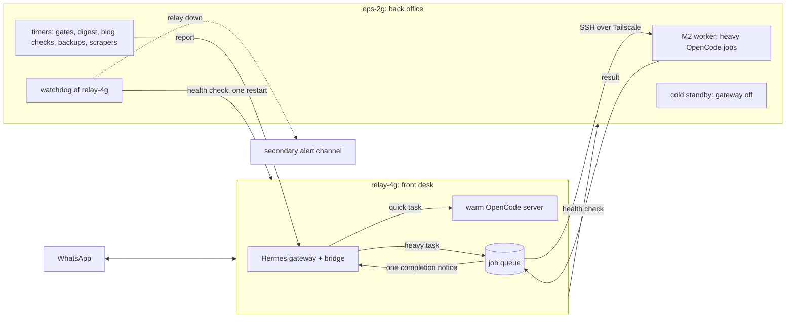

# Brief: two-host relay, `relay-4g` front desk and `ops-2g` back office (ADR-045, proposed)

Goal: the new 4 GB host (`relay-4g`) runs WhatsApp; the current 2 GB VPS becomes `ops-2g`, doing the heavy and scheduled work and watching `relay-4g`. The two are integrated over Tailscale. One WhatsApp gateway runs at any time, and only `relay-4g` sends WhatsApp messages.

Steps follow `relay/VPS_RELAY_RUNBOOK.md` and `relay/M2_DISPATCH_RUNBOOK.md` unless noted. **(owner)** marks owner-only steps.

## Phase 1: `relay-4g` takes over WhatsApp

| # | Step | Done when |
|---|---|---|
| 1 | **(owner)** Console login: add SSH public key, disable password login, cloud firewall allows SSH only | Key login works; password login refused |
| 2 | Base setup (runbook Step 1): updates, unattended upgrades, UFW default deny, linger for `ubuntu` | No public ports except SSH |
| 3 | Tailscale (Step 2), then close public SSH in the cloud firewall | Reachable only over the tailnet |
| 4 | Hermes at the same version as the live host (Step 3), gateway disabled | Versions match; gateway inactive |
| 5 | OpenCode, hub clone, relay guards and skill (Steps 4–5); `opencode-serve.service` enabled | `verify_model_routing.py` PASS; warm server active |
| 6 | Copy SOUL, dashboard themes, `naquuuu-activity` plugin, units and timers; apply ADR-044 tool and skill state | `hermes prompt-size --platform whatsapp` about 28 KB tool schemas |
| 7 | **(owner)** Provider keys, `~/.hermes/.env`, `NAQUUUU_WA_OWNER_IDS` | `hermes doctor` clean; nothing pasted into chat or the repo |
| 8 | Owner gate check before pairing (runbook Recovery, check 4) | Unknown sender denied tools in a synthetic test |
| 9 | **(owner)** Cutover: stop the old gateway, move the WhatsApp session (Step 6), start on `relay-4g` | One owner test message gets exactly one reply |

## Phase 2: integrate `ops-2g`

| # | Step | Done when |
|---|---|---|
| 10 | Rename the old host to `ops-2g` on the tailnet; gateway stays disabled; keep the rollback session copy | `relay-4g` reaches `ops-2g` by name; old gateway inactive |
| 11 | M2 worker: point `NAQUUUU_WORKER_HOST` at `ops-2g`, dedicated relay-to-worker key (`authorize_worker.sh`), drain timer on `relay-4g` | A dry-run job queues, drains and lands in `done/` |
| 12 | Completion notice: after a job lands in `done/` or `failed/`, `relay-4g` sends the owner one short WhatsApp line with the job id and result | Exactly one notice per job; no output body in chat |
| 13 | Timers on `ops-2g`: nightly gates (`verify_sanitization`, `verify_model_routing`, `sync_all_repos --strict`), weekly usage digest, daily blog checks, weekly encrypted Hermes backup; reports go to `relay-4g`, which messages the owner only on failure or for the weekly digest | Each timer runs once by hand and its report arrives through `relay-4g` |
| 14 | Watchdogs: `ops-2g` checks `relay-4g` (gateway, bridge, warm server, memory, disk) every 5 minutes, allowed one service restart; `relay-4g` checks `ops-2g` the same way | Stopping `opencode-serve` on `relay-4g` gives one restart and one notice |
| 15 | **(owner)** Choose the secondary alert channel for "relay-4g unreachable" | A simulated outage reaches the owner without WhatsApp |
| 16 | `relay_vps_status.py` reports both hosts; update `HOSTS.md`, `M2_DISPATCH_RUNBOOK.md`, ADR-045 to Accepted, STATUS | `sync_all_repos.py --strict` passes |

Rules: one heavy job at a time on `ops-2g`. Each host's SSH key for the other is limited to the commands it needs. Failover to the cold standby is an owner decision, never automatic. Rollback for phase 1: stop `relay-4g`'s gateway, start the old one (runbook Step 8).

Out of scope: moving the hub `.env`, changes to model routing (ADR-044).
